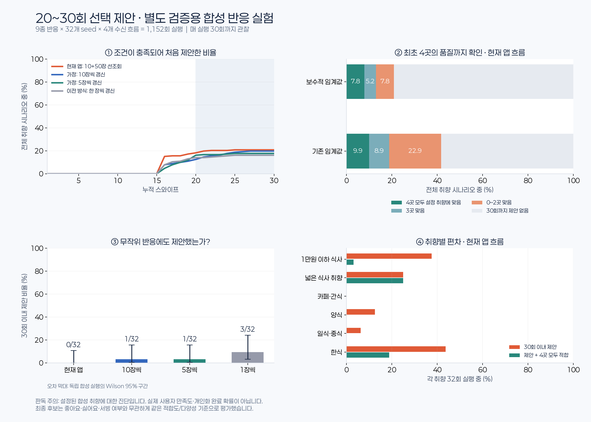
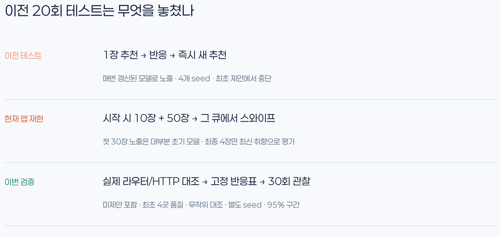

# 선택 제안 최종 검증 — 2026-09-14

> **판단 수치 export 추가:** [API·JSON/CSV 문서](../../../../server/DECISION-METRICS.md),
> [실제 API 측정 그래프](metrics-export-overview.png), [응답 예제](metrics-export-example.json).
> 고차원 벡터 성분별 유사도와 후보별 적합도/개인화 근거를 준비 전부터 내보낸다.
> 후속 회귀 검증은 320개 통과. 아래 312개 결과와 합성 성공률은 이전 구현 검증 시점의 기록이다.

> 후속 [설계 검토서](../../../../server/DECISION-DESIGN-REVIEW.md): 세 판단 기준의 타당성은 부족하다.
> 원시 유사도 분포·결측을 현재 1,629곳의 모든 쌍에서 실측하고, 개인화·적합도·조합의 측정 계약을
> 재정의했다. 아래 합성 실행 결과는 기존 휴리스틱에 대한 진단이며 재설계의 검증 결과가 아니다.

**서버 판정/4장 응답은 구현·검증했다. 다만 20~30회 안에 충분한 품질의 4곳을 안정적으로 제공한다는 제품 목표는 달성했다고 판단할 수 없다.**

기존 추천은 유지하며, 최종 후보의 과거 좋아요·싫어요·서빙 여부로 후보를 제한하지 않는다. 좋아요한 4곳을 모으는 별도 경로는 없다.

## 최종 결과 · 현재 앱 흐름

최종 검증용 seed 2000~2031. 취향 시나리오 6종×32 = 192건. 시작 시 10장+50장을 받아 두고 30회까지 반응한다. 1장/5장/10장 갱신은 비교 가정이며 앱 변경이 아니다.

| 지표 | 보수적 조건의 최종 결과 |
|---|---|
| 20회 이내 최초 제안 | 35/192 (18.2%) |
| 25회 이내 최초 제안 | 40/192 (20.8%) |
| 30회 이내 최초 제안 | 40/192 (20.8%) |
| 제안 + 최초 4곳 모두 설정 취향에 맞음 | 15/192 (7.8%) |
| 제안했지만 설정 취향과 맞는 곳이 0곳 | 6/192 (3.1%) |
| 무작위 반응에서 30회 이내 제안 | 0/32 · Wilson 95% 구간 0~10.7% |
| 합성 실행 중 개수/브랜드/세부 업종/수치 유사도 규칙 위반 | 0 |

분모에서 미제안 사례를 빼지 않았다. 제안된 경우만 보면 4곳 모두 맞은 비율은 **15/40 = 37.5%**이며, 이를 전체 성공률로 표현하면 안 된다. 정답은 합성 취향 가정이며 실제 사용자 만족도가 아니다.

기존 임계값(서로 다른 평가 12개·AUC .70)은 동일한 최종 후보/다양성 규칙에서 80/192가 제안됐고, 4곳 모두 적합은 19/192였다. 보수적 기준(16개·AUC .80)은 잘못된 권유 일부를 억제하지만 **전체 분모의 좋은 제안 수까지 늘린 것은 아니다**. 최종 holdout을 보고 기준을 다시 낮추지 않았다.

## 기존 20회 테스트가 부적절했던 이유

- 실제 앱의 초기 60장 선조회를 1장씩 즉시 갱신하는 방식으로 대체했다. 라우터의 배치 선발도 생략했다.
- 유형당 seed 4개뿐이었고, 조정에 사용한 사례와 독립 검증을 분리하지 않았다.
- 가게별 반응을 고정하지 않아 같은 가게도 정책에 따라 다른 라벨을 받을 수 있었다.
- 최초 제안에서 중단했고, 제안률/조건별 실패/최초 4곳의 품질을 충분히 구분하지 않았다.
- 업종으로 만든 합성 반응을 실제 취향 학습의 증거처럼 해석할 수 없었다.

## 교체한 실험의 범위

- 실제 production router를 사용하고, HTTP API와 60장 순서·20회 학습 상태가 일치하는 테스트를 통과했다.
- seed·가게별 고정 반응표로 같은 가게는 같은 응답을 갖는다. 매 실행 30회까지 관찰하며, 최초 제안을 나중의 좋은 제안으로 바꿔 세지 않는다.
- 개발 seed 0~7과 별도 최종 seed 2000~2031을 분리했다. 세부 업종 규칙 수정 전 사용한 1000~1031은 최종 검증으로 재사용하지 않았다.
- 최종 총 1,152개 실행(9종 반응×32seed×4경로), 총 34,560회 피드백. 같은 실행의 여러 시점을 독립 표본으로 세지 않았다.
- 6개 취향 가정은 한식/일식·중식/양식/카페·간식/넓은 식사/저가 식사이며, 대조군은 무작위/전부 싫어요/전부 좋아요다. 카테고리 5종 + 가격 조건일 뿐이며 실제 다차원 취향을 대표하지 않는다.
- 최종 판정은 제안 시점/정답 가게 수/무작위 권유/처리 지연을 함께 본다. 임계값 비교는 같은 후보·라벨·다양성 규칙에서 수행했다.

## 실제 API 응답 캡처

한식 합성 반응 seed 2000을 `/cards`와 `/preferences?include_decision=true`로 재생했다. **16회째 4장**이 반환됐고 시뮬레이터와 최초 제안 시점이 일치했다. 사진 4개 로드도 확인했다. 전체 성적을 대표하는 화면으로 선택한 것이 아니며, 모바일 앱 UI가 아닌 검증용 응답 뷰어다.

(실제 4장 응답 캡처는 가게 사진이 들어 있어 공개본에서 뺐습니다.)

수치 유사도만 검사한 초기 캡처에는 고깃집이 여러 곳 등장했다. 세부 업종 중복 금지를 추가하고, 변경 후 별도 검증을 다시 수행했다. 카테고리 정보가 없거나 부정확할 수 있으므로 사람의 지각적 다양성까지 보장하지는 않는다.

## 기능·성능 검증

- 최신 master의 설문/배포 변경을 통합한 후 **312 passed**, 16.88초. 의존성 deprecation 경고 2개.
- 최종 후보에 좋아요/싫어요/미평가/서빙 후 미응답이 모두 들어갈 수 있는지, 필터와 자격·자기 근거 제외·동일 세부 업종 중복 방지·4곳 조합 탐색·재생·OpenAPI·조회 상태 불변을 검증했다.
- `git diff --check` 통과. `validation-integrity.json`의 SHA256으로 검증 코드·모델·현재 앱 수신 코드·서빙 manifest의 일치를 확인했다.

| 현재 앱 흐름 내부 함수 지연 | 표본 | p50(ms) | p95(ms) | p99(ms) |
|---|---:|---:|---:|---:|
| 배치 서빙 | 576 | 12.99 | 24.87 | 26.59 |
| 학습 | 8640 | 7.34 | 15.59 | 16.71 |
| 본 판정 수행 | 310 | 78.79 | 118.18 | 129.44 |
| 초기 보류 | 8330 | 0.01 | 0.1 | 0.15 |

지연은 분석 프로세스 3개가 함께 실행되는 환경에서 측정한 내부 함수 값이다. HTTP·통신·단말 지연을 포함하지 않는다. 조기 보류의 낮은 p95를 전체 판정 비용으로 홍보하지 않는다.

## 운영 기록으로 확인할 수 있었던 것

현재 풀에 매핑되는 기록 2,218건, 프로필 71개를 읽기 전용으로 점검했다. 카탈로그 변경 이후 처음 평가한 프로필 중 30개 이상 서로 다른 가게를 평가한 5개를 진단 재생했으며, 첫 30개 기록에서는 제안이 없었다.

이 프로필들이 사람인지 테스트 스크립트인지 식별되지 않는다. 과거 필터·위치를 재구성하지 않은 무필터 진단이며 실제 서비스 재현 성적이 아니다. 노출 확률이 없고 최종 4곳의 후속 반응도 부족하므로 불편 오프라인 평가나 실제 만족도 추정을 할 수 없다. 실행 중 운영 파일은 갱신될 수 있고 파일 간 원자적 스냅샷도 아니다. 원본과 식별자는 산출물/MR에 넣지 않았다.

## 판단과 남은 제약

현 단계의 결과는 **동작하는 판정 API와 재현 가능한 검증**, 그리고 목표 미달을 보여주는 근거다. 배치 크기만 바꾸면 해결된다거나 30회면 충분하다고 결론내릴 수 없다. 현재 과거 예측 구분력/순위 안정성이 최종 4곳의 품질을 충분히 보증하지 못한다. 조건을 낮춰 제안 수를 채우는 방식으로 해결했다고 보고하지 않았다.

실제 사용자에게서 최종 4곳의 선택/거절과 후속 만족도를 수집해야 현실 적합도를 평가할 수 있다. 프론트 자동 권유/중복 억제/선택 UI/이벤트 기록은 아직 연동하지 않았고, 운영 배포·MR 병합도 하지 않았다. Draft MR에 결과와 제약을 유지한다.

## 근거·산출물

- [상세 설계와 재현 명령](../../../../server/DECISION.md)
- [집계 JSON](validation-results.json) · [검증 코드/데이터 해시](validation-integrity.json) · [운영 기록 진단 집계](operational-log-audit.json)
- [그래프 PDF](validation-overview.pdf) · [API 캡처 확인](api-example-check.json)
- 시뮬레이터 편향과 무작위 로그 기반 평가의 조건: [Li et al.](https://arxiv.org/abs/1003.5956). 이 실험은 해당 논문의 불편 replay 평가를 구현했다고 주장하지 않는다.
- 반복 관찰의 추론은 별도 시간 전체 보장이 필요함: [Howard et al.](https://arxiv.org/abs/1810.08240). 현재 AUC 임계값에 그런 보장이 있다고 해석하지 않는다.
