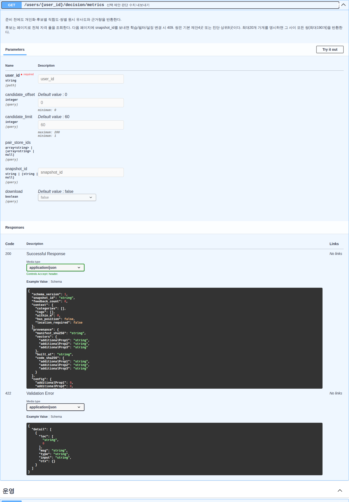

# 판단 수치 API 운영 배포 — 2026-09-14

> [기존 API 복원·수치 조회 분리 검증](../decision-separation-20260914/README.md)을 참고하세요.

**운영 배포 완료.** [운영 API 문서](http://api.example.com/docs)와 공개 HTTP 주소에서
엔드포인트·한국어 설명·다운로드 응답을 확인했다. 원격 브랜치는 `feat/be-rank-tier-distance`,
배포 코드 커밋은 `7b345e76e616aee0207bd73aef1778989d1963fc`다.

## 기존 흐름과의 연결

- 기존 `/cards` → `/preferences` 흐름, 사용자 식별자, 저장된 위치·필터·거리/태그 보정을 공유한다.
- `GET /users/{user_id}/decision/metrics`: 현재 시점의 수치·읽는 법·조건별 설명·후보/쌍 지표.
- `POST /preferences?include_decision=true&include_decision_metrics=true`: 선호 저장 후 제안과 수치를
  **같은 학습 스냅샷과 한 번 조회한 필터/위치 범위**에서 반환한다. 동시 피드백이 들어와도 시점을 맞춘다.
- 옵션 없는 기존 선호 호출은 기존 학습 흐름대로 동작하며 상세 수치를 계산하지 않는다.
- 최신 master의 데이터 외부 마운트 변경 `d7cd727`을 통합했다. 식당 데이터·벡터는 기존 서버 폴더를
  읽기 전용으로 연결하고, 사용자의 선호·설정은 기존 `backmock_state` 볼륨을 사용한다.
- 모바일 UI는 변경하지 않았다. 앱에서 수치를 받으려면 위 옵션을 붙이거나 GET을 별도 호출한다.
  새로운 자동4장 비교 화면 구현과 추천 기준의 실제 사용자 타당성 검증은 별도 과제다.

## 검증 결과와 의미

| 확인 | 결과 | 의미 |
|---|---|---|
| 기존 기능 및 연계 회귀 테스트 | **323 passed**, 10.83초, 의존성 경고2개 | 위치/필터/선호/동시 요청/설명 export 계약이 동작함. 취향 판단의 타당성을 증명하는 수치는 아님 |
| 격리 컨테이너에서 기존 흐름 실행 | 카드조회·위치·반경/업종 필터·선호 저장·결합 응답 통과 | 새 데이터 없이 현재 운영 카탈로그로 API 연계 확인. 쓰기 검증은 운영 상태를 복사한 격리 환경에서만 수행 |
| 공개 주소 `/healthz`, `/readyz` | 모두 **HTTP200** | 프로세스와 서비스 준비 상태 확인 |
| 공개 주소 metrics 조회 | **HTTP200** | 로컬 구현에 그치지 않고 운영 nginx를 거쳐 실제 응답함 |
| 설명 제공 | 현재 값의 한국어 해설, 조건별 설명, 지표 설명27개 묶음 | 숫자의 의미·단위·분모·한계·결측 규칙을 함께 받을 수 있음 |
| 선호 기록 복원 | 검사한 기존 프로필의 누적 학습296회 복원 | 기존 사용자 기록으로 새 서버가 모델을 복원함. 추천 성공률이나 사용자 수를 뜻하지 않음 |
| 기존 상태 파일6개 | 배포 전 바이트 구간의 해시가 모두 일치 | 기존 기록을 손실/치환하지 않았음. 배포 후 추가된 기록은 허용하는 검사 |
| 원본 데이터·상태 마운트 | 기존 폴더/볼륨 유지 | 배포 이미지로 예전 식당 데이터나 빈 사용자 상태를 덮지 않음 |

검증 시각·이미지 ID·세부 결과는 [production-verification.json](production-verification.json)에 있다.
운영 검증에서는 실제 사용자 선호를 쓰지 않았으며, 결과 파일에는 사용자 식별자나 원본 이력을 포함하지 않았다.



위 화면은 **운영 API 문서 캡처**다. Swagger의 `Example Value`는 스키마 예시이며 실제 사용자 응답이 아니다.
실제 HTTP 응답 검사는 검증 JSON의 `production_read_only_checks`에 따로 기록했다.

## 호출 방법

`USER_ID`를 기존 사용자 ID로 바꾸어 사용한다.

```bash
curl 'http://api.example.com/users/USER_ID/decision/metrics?candidate_limit=60&download=true' \
  -o decision-metrics.json
```

전체 후보 JSON·CSV·한국어 해설 파일은 다음 도구로 내려받는다.

```bash
cd BE
python analysis/export_decision_metrics.py \
  'http://api.example.com/users/USER_ID/decision/metrics' \
  --output-dir /tmp/decision-export
```

응답과 해석의 상세 계약은 [DECISION-METRICS.md](../../../../server/DECISION-METRICS.md).

## 배포 추적과 복구

- 배포 이미지: `backmock-app:decision-7b345e7`.
- 이미지 revision 라벨과 배포 커밋을 대조했다. 운영 컨테이너는 `backmock-app-1`, 상태는 healthy.
- 기존 Compose 구성 위에 이미지 항목만 지정하여 앱을 교체하고 nginx 문법 검사·리로드를 수행했다.
- 이전 이미지: `backmock-app:before-decision-20260914`. 상태 백업·배포/복구 override는
  서버의 `/home/ubuntu/matchuri-changes/decision-deploy-20260914/`에 제한된 권한으로 보관한다.
- 검증 스크립트: [verify_decision_deploy.py](../../../../server/scripts/verify_decision_deploy.py).
  `--isolated-write`는 별도의 격리 컨테이너용이며 운영 확인은 사용자 ID를 지정한 읽기 전용 검사다.
- MR은 병합하지 않았다. 기존 Jenkins는 master를 체크아웃하므로 후속 master 배포에 이 기능을
  유지하려면 배포 대상 코드에 이 MR 변경이 포함되어 있어야 한다.
