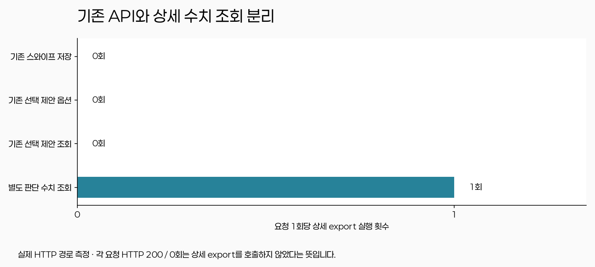

# 기존 API 유지·상세 수치 별도 조회

기존 선택 제안 응답을 확장했던 `next_action`, `assessment`, 카드의 `fit`을 제거했다.
기존 카드 조회·스와이프 저장·선택 제안은 종전 계약을 유지하고, 판단 수치와 설명은
필요할 때 `/users/{user_id}/decision/metrics`에서 별도로 조회한다.
이미 있던 선택적 쿼리 옵션은 호환성을 위해 유지한다. 새 API나 화면은 추가하지 않았다.

운영에 먼저 들어간 최신 master `fa91d97`의 고정 카드 ID·요일별 영업시간·현재 영업 상태 기능도
통합해 보존했다. 해당 구현 파일과 Dockerfile/ID 기준선은 master와 동일하다.

## 검증

- 전체 회귀 **391 passed / 11.97초**, 기존 의존성 경고2개.
- 상세 export 함수를 호출하면 실패하도록 두어도 기존 저장/선택 제안 API가 정상 작동한다.
- 상세 조회 실패(503)를 재현해도 별도 저장/선택 제안 요청은 정상 작동한다.
- 실제 HTTP 경로에서 요청별 상세 export 호출 수를 계측: 기존 저장0, 기존 제안 옵션0,
  기존 제안 조회0, 별도 수치 조회1. 각 요청 HTTP200. 0은 상세 계산 의존이 없다는 뜻이다.
- 수치 GET은 읽기 전용이며 기존 한국어 의미와 결측 규칙을 유지한다.
- 최신 카드 ID·영업시간 관련 테스트도 전체 회귀에 포함된다.

[계측 집계](verification.json) · [연동 방법](../../../../server/DECISION-CLIENT.md).
회귀 재현: `cd BE/server && python -m pytest tests -q`.
분리 경계 검증은 `tests/test_decision_separation.py`에 있다.

이 변경은 API 역할 정리다. 기존 추천 기준을 바꾸거나 추천 정확도를 입증하지 않는다.
별도 GET은 조회 시점의 상태이며 이전 POST와 같은 시점이라고 가정하지 않는다.

## 운영 확인

2026-09-14 15:09 KST, 공개 주소에서 확인 완료. 배포 코드 `fd02bfd`, 이미지
`backmock-app:decision-separated-fd02bfd`. 기존 제안 응답의 결합 필드 제거와 별도 수치·설명 조회,
카드 ID/영업시간 기능 보존을 확인했다. 기존 로그6개 바이트 해시와 원본 마운트/상태 볼륨도 유지됐다.
검증용 컨테이너는 제거했고 운영에는 테스트 선호를 쓰지 않았다.
[운영 검증 JSON](production-verification.json)에 확인 결과를 기록했다.

이전 운영 이미지 `backmock-app:before-separation-20260914`와 배포 전 상태 백업을 보관한다.
MR은 병합하지 않았다. 기존 Jenkins가 master를 배포하므로 후속 master 배포에 변경이 포함되어야 유지된다.
