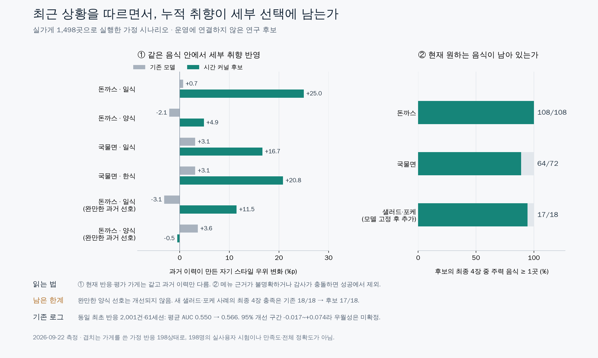

# 최근 상황과 누적 취향을 함께 추정하는 실험

**연구 후보이며 운영 추천에는 연결하지 않았다.** 기존 API·클라이언트·추천 정책은
그대로다. `server/`는 이 디렉터리를 import하지 않는다.

최신 확장 검증은 [음식 6종·속성 10축 교차 측정](attribute_matrix/README.md)이다.
3,168개 가정 상태에서 실제 38,016장을 확인했다. 요리권·조리법 등의 작은 점수 전이,
맛 표현의 불안정, 최종 네 장에서의 소실·반대 방향, 좋아요 재추천과 새 가게 발견을
구분한다. 아래 이전 연구와 운영 모델 전환 여부를 혼동하지 않는다.

과거 일식·한식·중식·양식과 밥·면·육류·해산물 선호를 바꾼
[180조건 교차 측정](preference_matrix/README.md)을 추가했다. 같은 이력 수의 중립
대조와 이력 없음 대조를 구분하고, 운영·연구의 실제 네 장과 미학습 가게 순위를
따로 기록한다. 일식 돈까스와 면 전이의 작은 효과, 양식 이력과 한식 육류의 불안정,
측정할 메뉴 근거가 부족한 칸을 함께 보고한다.

**[미세 취향 감사](nuance_audit/README.md)는 해석 기준을 설명한다.** 첫 카드가 같거나
스타일이 과반이 아니라는 이유만으로 실패라고 판단하지 않는다. 현재를 고정한 과거
대조, 실제 후보 수 차이, 다양성 교환에서의 적합도 손실을 따로 검증했다.

과거 이력 N을 바꾼 정밀 검증과 개선은
[`history_depth/README.md`](history_depth/README.md)에 정리했다. 186개 가정 경로의
948개 상태에서 실제 4장·모집단 분모·4,317차원 계수 변화를 측정한다.
`regularized.py`는 한 종류의 반응에서도 취향 계수를 학습하는 유한 절편 사전분포를
추가한 별도 후보이며, `model.py`의 이전 결과는 그대로 재현할 수 있다.
실제 후보 추천은 전체 사후 예측을 사용하고 자기 반응 제외(LOO)는 별도 비교군으로
남긴다. 미관측 가게의 예측은 두 계산에서 정확히 같으며, 알려준 좋아요 재추천은
일반화 정확도로 세지 않는다. 아래는 이전 v1 모델과 개발 실험의 기록이다.

검증하려는 것은 두 가지다. 오늘 돈까스를 원한다면 돈까스가 상위에 남아야 하고,
그 안에서는 과거 일식 선호가 일식 돈까스의 순위를 올리는지 확인한다. 국물면,
완만한 과거 취향, 돈까스→면→돈까스 전환도 같은 방식으로 비교한다.

## 모델

- 메뉴·설명·리뷰·음식 사진 유사도를 중심화한 뒤 양의 고윳값으로 잠재공간을 만든다.
  음식명·업종·실험 정답을 모델 특성에 추가하지 않는다. MaxSim은 PSD가 아닐 수 있어
  음의 스펙트럼을 제거하며, 제거량과 누락 특성을 진단값으로 남긴다.
- 그 공간에서 지속되는 선호와 빠르게 변하는 상황을 함께 추정하는 시간 커널을 쓴다.
  기본 공분산은 `K(i,j) × (0.1 + 2^(-|t_i-t_j|/10))`, 관측 잡음 분산은 `1`이다.
  이 값들은 고정한 **실험 가정**이며 최적값이나 만족 확률로 검증된 수치가 아니다.
- `0.1`은 지속 성분의 사전 분산이다. 이전 세션의 점수를 일정 비율만 섞는 계수가
  아니다. 모든 관측을 함께 풀고, 새 반응에 따라 각 관측의 실제 예측 계수가 달라진다.
  지속 성분 자체에는 시간 감쇠가 없으며, 그 추정치가 새 반응으로 갱신된다.
- 세션을 열어도 모델·관측 나이를 바꾸지 않는다. 유효한 스와이프만 시간을 진행시킨다.
  같은 가게를 재평가하면 마지막 반응과 그 시점만 남긴다.
- 후보 자신의 반응은 과거 세션에 있더라도 예측에서 정확히 제외한다. 다른 관측의
  시각과 현재 시각은 유지한다. 따라서 기억한 좋아요를 다시 맞힌 것을 일반화 성공으로
  세지 않는다. 빠른 삭제 계산은 관측을 실제로 삭제하고 다시 푼 결과와 대조했다.

현재 기본값의 카탈로그 잠재공간은 4,317차원이다. 기존 운영의 8개 콘텐츠 성분 가중치와
의미가 다르므로, 새 점수에 기존 `m × z` 설명을 그대로 붙이면 안 된다.

## 재현

```bash
cd BE
OPENBLAS_NUM_THREADS=1 python -m pytest analysis/temporal_taste -q
OPENBLAS_NUM_THREADS=1 python -m analysis.temporal_taste.bench \
  --serving /path/to/kakao/serving \
  --output /tmp/temporal-taste-results.json
```

`scenarios.json`은 실가게 ID에 대한 **가정한 반응**이다. 실제 사용자 기록이나 원본
메뉴·리뷰·벡터를 포함하지 않는다. 144개 경로에서 180개 상태를 측정하며, 가게가 여러
seed에 반복되므로 180명의 독립 사용자 시험이 아니다. 이 사례들은 모델 비교에 쓴
개발 사례이며, 손대지 않은 최종 테스트셋으로 주장하지 않는다.

CLI는 독립 프로세스에서 실행한다. 서버를 기동하거나 사용자 DB를 복원하지 않고,
가게 카탈로그와 서빙 행렬만 읽는다. 리뷰 순위 캐시는 임시 폴더에 쓴다. 입력 행렬,
ID 순서, 라벨 감사에 쓴 원자료의 SHA를 확인하며 다르면 기본 실행을 거부한다.
`--allow-catalog-change`는 다른 카탈로그를 의도적으로 실험할 때만 사용한다.

출력에는 현 운영 모델과 연구 모델의 후보 순위, 평가용 음식군 비교, 기존 선택기로
고른 실제 4장이 함께 담긴다. 작은 평가 음식군 밖의 후보도 전체 메뉴로 확인해야 한다.
평가용 가게는 과거·현재 반응 모두에서 제외한다. 최종 4곳을 모두 같은 음식으로
만들어야 한다는 조건은 두지 않는다.

## 현재 확인된 범위

고정된 180개 상태에서 기존 선택기가 모두 4장을 반환했다. 후보 자신의 반응을
제외하고 불확실성 차감까지 적용한 최상위 결과에서:

| 가정한 현재 상황 | 주력 음식이 유지된 상태 |
|---|---:|
| 돈까스, 강한/완만한 과거 선호 | 72 / 72 |
| 국물면 | 49 / 54 |
| 돈까스→면→돈까스 전환·복귀 | 48 / 54 |

이는 **실제 가게 데이터로 실행한 가정 시나리오의 메뉴 감사 결과**다. 사람의 만족도나
전체 추천 정확도가 아니다. 메뉴가 불명확한 곳은 성공으로 세지 않았다.

최종 4장 안에 원하는 주력 음식이 적어도 한 곳 있는지 따로 확인했다. 돈까스는
108/108, 면은 감사 라벨이 충돌하는 가게까지 보수적으로 제외하면 64/72였다.
4장 전체의 적합도나 다양성이 개선됐다는 뜻은 아니다.

과거 취향의 효과는 **같은 현재 반응·같은 평가 후보에서 과거 이력만 바꿔** 비교한다.
국물면 개발 사례에서 자기 스타일을 더 높게 두는 비교 비율은 일식 +16.7%p,
한식 +20.8%p였다(모델 평균 점수 기준). 완만한 돈까스 선호에서는 일식 +11.5%p,
양식 −0.5%p로, 모든 방향에서 세부 취향을 잘 전달하지는 못했다.

모델을 고정한 뒤 **튀김 선호→현재 샐러드·포케**를 별도로 추가했다. 전체 메뉴를
확인해 가게군을 정하고, 모델 점수를 보기 전에 반응·평가 가게·순서를 고정했다.
6개 seed에 과거 없음/튀김 선호/반대 선호를 적용한 18개 상태다. 각 seed 안에서
과거 세 조건의 현재 20회 반응은 동일하며, 과거 40회와 평가 가게 사이에
가게·확인된 브랜드 중복이 없도록 했다.

```bash
OPENBLAS_NUM_THREADS=1 python -m analysis.temporal_taste.bench \
  --serving /path/to/kakao/serving \
  --fixtures analysis/temporal_taste/scenarios_salad_shift.json \
  --output /tmp/salad-shift-results.json
```

이 새 사례에서는 미학습 샐러드 4곳과 튀김 4곳의 비교 방향을 두 모델 모두 전부
맞혔다. 다만 최종 4장에 샐러드·포케 주력 가게가 확인된 경우는 **기존 18/18,
후보 17/18**이었다. 후보의 나머지 1회는 수집 메뉴가 불명확해 성공으로 세지 않았다.
미학습 샐러드의 평균 보수 순위도 기존 13.44위→후보 18.35위로 나빠졌다.
새 음식에서도 기존보다 항상 우수하다고 주장할 수 없다. 이 결과를 본 뒤 모델이나
입력 사례를 다시 조정하지 않았다.

기존 180개 상태의 최종 4장도 같은 메뉴 기준으로 대조했다. 기존 모델의 미감사
101카드와 라벨 충돌을 모두 고려하면, 원하는 주력 음식 포함 범위는 돈까스
기존 100~102/108→후보 108/108, 국물면 기존 55~67/72→후보 64~71/72다.
돈까스 개선은 이 범위에서도 유지되지만 국물면의 우위는 단정할 수 없다.

기존 운영 로그의 동일한 최초 반응 2,001건·61세션·10명을 응답 전에 예측했을 때,
세션 평균 AUC는 기존 0.550→후보 0.566이었다. 사용자 단위 bootstrap 95% 개선 구간은
−0.017~+0.074로 0을 포함한다. 기존 노출 정책의 편향과 테스트 계정 가능성이 있어
실사용 성능 개선을 확정하거나 A/B 테스트로 표현하지 않는다. 원본 로그는 Git에 없다.
AUC는 좋아요한 가게를 싫어요한 가게보다 높게 두는 구분력이다(무작위 0.5, 완벽한
순서 1.0). 특정 가게를 좋아할 확률이나 취향 수집도 점수가 아니다.

수학·상태·평가 누출 방지 테스트 45개를 통과했다. 정리한 구현은 기존 고정 실험의
180개 상태에서 평균/보수 점수 top20 총 360개 목록과 최종 4장이 동일했다.



수치·집계 기준·재현 입력 해시는 [`validation.json`](validation.json)에 있다.
그림과 위 결과는 모델 선택에 쓴 180개 상태와 모델을 고정한 뒤 추가한 18개 상태를
구분한다. 실제 로그는 별도 관찰 검증이며 원본 사용자 기록은 포함하지 않는다.

## 운영 전환 전에 필요한 경계

- 단일 종류의 응답만 있으면 자유 절편 때문에 예측이 상수다. 관측이 없으면 절편의
  불확실성도 식별되지 않는다. 기존 콜드스타트와 이어지는 동작을 검증해야 한다.
- GP 평균·표준편차는 현재 8D 로지스틱 점수와 단위가 다르다. 이번 선택기 실행은
  기존 `personal > 0`, `0.5 × 불확실성` 규칙을 그대로 대입한 검증이지, 스키마의
  수치 의미까지 호환된다는 증명이 아니다.
- swipe의 탐색, decision, 진행도용 응답 전 예측, 지도·추천 설명, 세션 복사와
  스냅샷 복원이 같은 모델을 사용해야 한다. 현재 기본 interleave에는 legacy도
  참여하므로 taste 점수 함수 하나만 바꿔서는 전체 시스템 전환이 되지 않는다.

이 경계를 검증 없이 넘겨 운영에 적용하지 않는다. 연구 모델·검증 코드의 반영과
운영 추천 모델의 교체를 구분한다.
