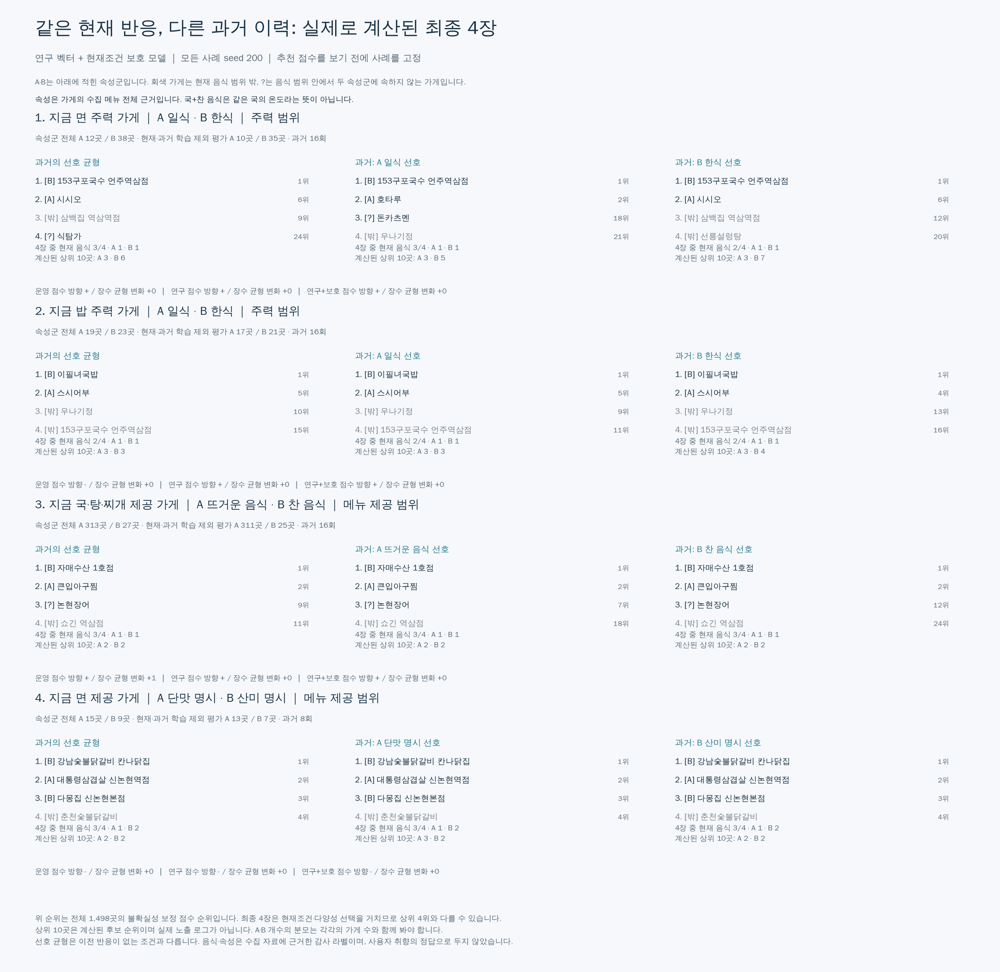
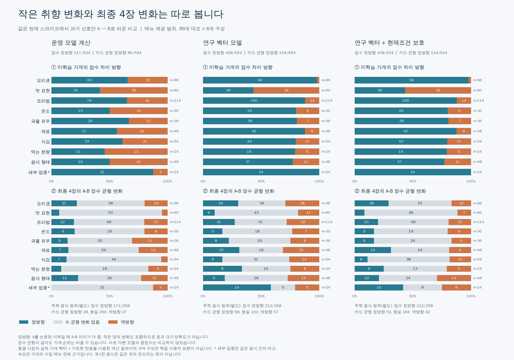
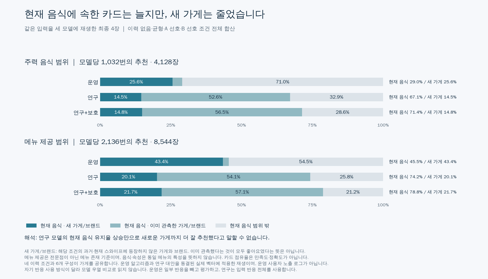
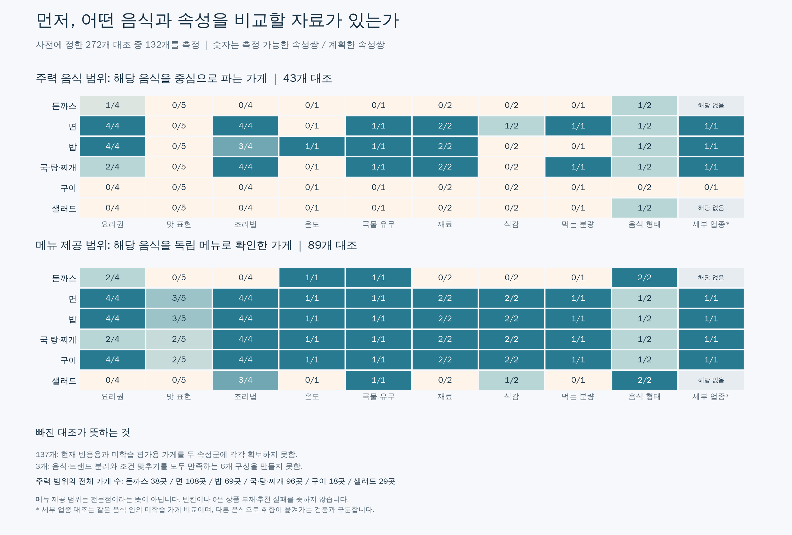

# 음식과 속성을 넓혀 확인한 과거 취향의 영향

**과거 취향이 현재 음식 안의 세부 점수를 조금 바꾸는 현상은 돈까스 밖에서도 확인됐다. 다만 맛 전반이나 최종 추천 네 장까지 일관되게 반영된다고 말할 단계는 아니다.**

실가게 1,498곳을 사용해 돈까스·면·밥·국/탕/찌개·구이·샐러드를 조사했다. 요리권, 맛 표현, 조리법, 온도, 국물 유무, 재료, 식감, 식사 분량, 음식 형태, 세부 업종의 **10축·26개 대조**다. 자료와 브랜드 분리 조건을 충족한 132조합을 각각 6가지 표본 구성·4가지 과거 이력으로 재생했다. 총 **3,168상태·9,504회 추천·38,016장**을 계산했다.

실제 사용자 만족도 시험은 아니다. 같은 현재 반응에 과거 선호만 바꾸는 가정 실험이며, 모델과 선택 규칙은 결과를 보기 전에 고정했다. 이 문서의 **운영 모델**은 동결 카탈로그에서 운영 계산을 재생한 비교군이고, **연구 모델/현재조건 보호**는 운영에 연결하지 않은 후보다. 이번 변경은 검증 도구와 측정 자료이며 API·클라이언트·운영 추천 모델을 바꾸지 않는다.

## 먼저 무엇을 판단할 수 있는가

| 관찰 | 사용자 관점의 의미 | 아직 말할 수 없는 것 |
|---|---|---|
| 연구 모델의 주력 음식 요리권 대조 66/66에서 과거 선호 쪽으로 미학습 점수 차이가 이동 | 면·밥·국에서도 이전 요리권 취향이 세부 선호로 남을 수 있다 | 요리권 정확도 100%, 최종 네 장 보장 |
| 같은 66대조의 실제 네 장 구성은 정방향 17, 반대 24, 같은 균형 25 | 점수에 남은 작은 효과가 최종 선택 과정까지 일관되게 보존되지는 않았다 | 같은 장수라는 이유만으로 개인화 실패라고 판단 |
| 맛 표현 대조는 연구 26/60, 운영 25/60에서 원하는 점수 방향 | 추출한 맛 표현을 가진 가게군 사이에서는 안정된 전이 근거가 부족하다 | 매운맛·단맛 등 실제 개인의 맛 취향을 전반적으로 이해함 |
| 연구 모델의 현재 음식 카드 비중은 증가했으나 새로운 가게·브랜드의 현재 음식 카드는 감소 | 이미 알려준 좋아요를 재추천한 효과가 크다 | 신규 추천 정확도가 좋아졌다는 결론 |

여기서 **정방향**은 A를 좋아했던 이력에서 `A군 평균 점수−B군 평균 점수`가 B 선호 이력보다 커졌다는 뜻이다. 아주 작은 변화도 포함한다. 사람의 정답을 맞힌 비율이나 좋아할 확률이 아니다. A 가게가 과반이거나 첫 번째여야 한다는 기준도 두지 않았다.

## 면·밥·국에서 실제로 나타난 작은 변화

아래는 연구 모델의 미학습 가게 점수 차이다. 현재 20번 반응은 그대로 두고, 동일한 과거 가게에 대한 반응만 중립/A 선호/B 선호로 바꿨다. 사례는 추천 결과를 보기 전에 고정한 seed 200이다. 점수의 단위는 모델 내부 단위이며 운영 모델과 크기를 직접 비교하지 않는다.

| 지금 찾는 음식 · 과거 대조 | 미학습 A/B 가게 수 | 중립 점수 차 | A 선호 이력 | B 선호 이력 | 읽어야 할 의미 |
|---|---:|---:|---:|---:|---|
| 주력 면 · 일식/한식 | 10 / 35 | +0.01084 | +0.03229 | +0.00199 | 현재 면 선호를 유지한 채 일식 이력은 일식 면 쪽으로 상대 점수를 조금 올림 |
| 주력 밥 · 일식/한식 | 17 / 21 | −0.08076 | −0.05073 | −0.09027 | 한식 밥의 기존 우위를 일식 이력이 완화함. 과거 취향이 현재 순서를 강제로 뒤집지 않아도 영향은 존재 |
| 국 제공점 · 뜨거운/찬 음식 근거 | 311 / 25 | +0.07808 | +0.09572 | +0.05881 | 해당 메뉴 근거가 있는 가게군 사이의 상대 이동. 같은 국의 온도 비교는 아님 |
| 면 제공점 · 단맛/산미 명시 | 13 / 7 | −0.02855 | −0.03844 | −0.02190 | 기대 방향과 반대. 이 구성으로 단맛/산미 전이를 뒷받침할 수 없음 |

각 대조의 여섯 구성에서도 면 일식/한식은 6/6, 밥 일식/한식은 6/6, 국 제공점 온도는 5/6이 정방향이었다. 면 제공점 단맛/산미는 **0/6**이었다. 마지막 사례는 결과를 본 뒤 빼거나 다른 가게로 교체하지 않았다. 이 사례는 사전에 계산한 벡터 방향 진단에서 어려운 대조로 확인되어 포함했으므로, 모든 정보에 대해 맹검으로 뽑은 사례는 아니다.

전체 주력 면 모집단은 일식 12곳·한식 38곳이다. 같은 사례의 연구+현재조건 보호 후보 상위 10곳은 일식 이력에서 일식 3/한식 5, 한식 이력에서 일식 3/한식 7이었다. **한식 가게가 더 많은 상황을 유지하면서 일부 순위가 움직인 모습**이다. 이 목록은 실제 노출 빈도나 최종 네 장이 아니라 계산상 상위 후보다.

최종 네 장의 일식/한식 장수는 이 면 사례에서 모두 1/1이었다. 일식 이력에서는 시시오 대신 호타루 등이 선택되어 가게 자체는 바뀌었지만, 호타루는 현재 좋아요한 가게였다. 밥 사례는 점수가 바뀌어도 이필녀국밥·스시어부·우나기정·153구포국수 언주역삼점 네 곳이 그대로였다. **같은 구성비, 같은 가게, 같은 점수는 서로 다른 판단이다.**

## 10개 속성 축 전체의 결과

맛 표현까지 비교 가능한 **메뉴 제공 범위**의 결과다. 주력/공동주력 범위는 별도 그림에 있다. 두 범위는 가게가 겹치므로 독립 표본처럼 합산하지 않는다. 속성별 사례 수 차이는 자료의 측정 가능성에 따른 것이며 중요도나 추천 할당량이 아니다.

| 속성 축 | 운영: 과거 선호 쪽으로 점수 이동 | 연구: 같은 지표 | 해석 |
|---|---:|---:|---|
| 요리권 | 63/96 | 94/96 | 조사한 속성 중 방향이 비교적 일관됨 |
| 맛 표현 | 25/60 | 26/60 | 반대 방향도 많아 일반적인 맛 전이를 주장하기 어려움 |
| 조리법 | 74/114 | 100/114 | 튀김·구이·찜/조림·볶음·생식 구분에서 유망하지만 예외 존재 |
| 온도 | 15/30 | 24/30 | 온도 근거가 있는 가게군에서 작은 이동; 음식 자체의 실측 온도 아님 |
| 국물 유무 | 24/36 | 29/36 | 국물 메뉴 근거의 전이. 곁들임 국과 주력 국은 구분해 추출 |
| 재료 | 27/48 | 42/48 | 육류·해산물·채소 근거. 식단 적합성이나 주재료 비중 보장 아님 |
| 식감 | 33/54 | 43/54 | 바삭함·쫄깃함·부드러움의 명시 근거에서 대체로 같은 방향 |
| 식사 분량 | 11/24 | 19/24 | 명시 1인/다인 분량. 혼밥 만족도나 분위기를 대신 측정하지 않음 |
| 음식 형태 | 24/48 | 37/48 | 면/밥, 국/구이의 형태 근거에서 일부 전이 |
| 세부 업종 | 21/24 | 24/24 | 같은 음식 내부의 카테고리 일반화. 다른 음식으로의 전이 증거와 별개 |

작은 점수 이동이 최종 네 장 구성에 나타나는지는 아래 그림의 하단에 따로 표시했다. 같은 장수인 경우에도 가게·순위는 바뀔 수 있다. 반대 방향이 나온 경우를 모두 모델 버그라고 단정하지는 않는다. 후보별 점수, 불확실성, 가게 간 다양성이 함께 작용하는 실제 선택 결과이기 때문이다.

[주력 음식 범위 그림](information-effects.png)에서는 요리권의 점수 방향이 운영 51/66, 연구 66/66이었다. 반면 연구의 실제 네 장 구성은 정방향 17/66에 그쳤다. 현재조건 보호를 적용해도 정방향 14, 반대 19, 같은 균형 33이었다. **현재 조건을 보호하는 것만으로 과거 취향의 미세한 영향까지 최종 카드에 보존되지는 않았다.**

## 현재 음식 유지와 새로운 가게 발견은 별개다

주력 음식 범위 1,032상태 × 4장 = 4,128자리의 실제 결과다.

| 계산 경로 | 현재 음식 가게 | 그중 새 가게·새 브랜드 | 그중 현재 세션 좋아요 가게 |
|---|---:|---:|---:|
| 운영 모델 | 1,197/4,128 (29.0%) | 1,058/4,128 (25.6%) | 75 |
| 연구 모델 | 2,771/4,128 (67.1%) | 600/4,128 (14.5%) | 2,110 |
| 연구 + 현재조건 보호 | 2,947/4,128 (71.4%) | 613/4,128 (14.8%) | 2,286 |

같은 브랜드의 다른 지점, 과거 좋아요/싫어요 가게도 별도로 존재하므로 `새 가게가 아님`을 전부 좋아요로 부르지 않았다. 전체 메뉴 범위에서도 현재 음식 비중은 45.5%→74.2%로 늘지만 새 가게·브랜드인 현재 음식 카드는 43.4%→20.1%로 줄었다.

또한 **운영은 관측 가게의 자기 반응을 유사도 성분에서 제외하고, 이번 연구 경로는 자기 반응을 포함한 전체 예측을 사용한다.** 두 경로의 카드 유지율 차이를 순수한 모델 성능 향상으로 해석하면 안 된다. 미학습 가게의 점수 대조와 이미 좋아요한 가게 재등장을 분리한 이유다.

이는 좋아요한 가게를 다시 추천하면 안 된다는 뜻이 아니다. 최종 결정에는 유용할 수 있다. 다만 사용자 가설인 **다른 음식에서 쌓인 세부 취향을 새 후보에도 조금 반영한다**는 주장에는 미학습 후보와 새로운 추천의 근거가 더 필요하다.

가능성을 더 정확히 보기 위해 실제 네 장 중 **새 가게·새 브랜드만** 사후 분해했다. 메뉴 범위 534대조에서 운영의 A−B 장수 변화는 정방향 80/반대 93/같음 361, 연구는 정방향 97/반대 54/같음 383이었다. 새 추천에서도 작은 취향 차이가 남는 유망한 신호는 있다. 다만 새 추천 총량이 감소했고 동률이 많으며 자기 반응 처리도 다르므로 운영 교체의 충분한 근거는 아니다. 이 분해는 사전 합격 기준이 아닌 추가 진단이다([근거](posthoc-card-decomposition.json)).

## 벡터에서 확인한 것과 그 의미

연구 모델의 4,317차원 실제 학습 계수와 전체 가게 예측을 저장했다. 모든 상태에서 `가게 벡터 × 학습 계수 + 절편`이 저장한 예측을 재구성했으며 최대 오차는 **7.77×10⁻¹⁶**이었다. 점수 이동을 설명용 가짜 수치로 만든 것이 아니라 실제 모델 계산과 연결했음을 확인하는 검산이다.

별도 진단은 과거 A/B 가게군을 나누는 평균 벡터 방향과 현재 음식의 미학습 A/B 방향을 비교한다. 요리권 162대조는 모두 같은 방향이었고 평균 코사인 유사도는 +0.3382였다. 맛 표현 60대조는 양/음 방향이 30/30이고 평균 +0.0124였다. **이번 가게군에서는 요리권 차이가 음식 사이에 더 일관된 방향으로 표현된 반면, 맛 표현은 그만큼 정렬되지 않았다는 뜻**이다. 분류 정확도나 실제 학습 효과의 인과 설명은 아니다.

개별 좌표를 ‘단맛 축’, ‘일식 축’이라고 이름 붙이지 않았다. 메뉴·요리권·조리법 등 속성이 함께 얽힌 잠재공간이며, 가게군의 실제 점수 변화와 함께 읽어야 한다. 전체 벡터를 더 크게 움직이는 것이 목표도 아니다.

## 측정하지 못한 부분과 필요한 조건

계획한 272조합 중 140조합은 미측정이다. 137개는 현재/평가 가게·브랜드가 부족했고 3개는 과거·현재의 요리권 짝맞춤과 분리 조건을 충족하지 못했다. 0효과나 실패로 채우지 않았다. 주력 구이는 이번 설계에서 측정 가능 조합이 0개, 메뉴 제공 범위에서는 19개다.

- 매운맛/순한맛은 순한맛만 명시된 가게가 4곳이라 이번 분리 조건을 충족하지 못했다. 매운맛 표현이 없다는 이유로 순한맛이라고 추정하지 않았다.
- **가게의 메뉴 전체에 속성 근거가 존재한다는 라벨**이다. ‘면 제공 + 단맛 근거’가 반드시 단맛 나는 면을 뜻하지 않고, ‘국 제공 + 찬 음식 근거’가 차가운 국을 뜻하지 않는다. 이 실험으로 개별 메뉴의 맛 취향을 직접 검증했다고 말하면 안 된다.
- 미세한 맛 전이를 더 정확히 검증하려면 동일 메뉴에 음식 형태·맛·조리법을 연결한 근거, 가게의 대표성, 현재와 과거를 분리할 만큼의 가게/브랜드 수가 필요하다. 실제 사용자가 어떤 메뉴를 보고 반응했는지도 있으면 가설을 더 직접 검증할 수 있다.
- 그 조건에서도 과거와 현재 음식 사이의 같은 속성이 잠재공간에서 비교 가능한 방향으로 표현되는지 확인해야 한다. 이번 맛 방향 진단은 이 가정이 자동으로 성립하지 않음을 보여준다. 고차원이라는 이유만으로 모든 미세한 속성이 잘 분리되지는 않는다.
- 최종 카드 단계에서는 작은 적합도 차이가 불확실성·다양성 교환에서 어떻게 유지되거나 사라지는지 검증해야 한다. 특정 속성 비율을 억지로 맞추는 조건을 넣지 않았다.
- 운영 전환의 판단에는 자기 반응을 쓰는 방식의 차이를 분리하고, 동일한 실제 사용자 노출에서 새 후보의 반응을 확인해야 한다. 이번 6개 구성은 같은 카탈로그를 재사용하므로 독립 사용자 6명이나 통계적 유의성의 근거가 아니다.

따라서 기술적 가능성을 부정하는 결과가 아니다. **요리권·조리법·재료 등에서 작은 전이의 근거는 있고, 맛과 최종 선택에서는 측정 근거와 보존 방식에 남은 과제가 있다**는 결과다. 원하는 비율이 나올 때까지 모델이나 사례를 조정하지 않았다.

## 설계·검증·자료

현재 20반응은 해당 음식의 A/B 가게 각각 2곳 좋아요, 다른 음식 16곳 싫어요다. 현재 속성을 직접 한쪽으로 밀지 않도록 긍정 반응 순서를 구성별로 교대했다. 과거는 가능한 경우 16개, 자료가 부족하면 8개다. 동일한 과거 가게·순서·총 좋아요 수를 유지하고 중립/A 선호/B 선호/이력 없음 네 조건을 둔다. 과거·현재·평가의 가게와 브랜드를 분리한다. 요리권·카테고리 자체 비교 외에는 과거/현재 A/B의 원천 요리권 구성도 맞췄다. 자세한 규약은 [protocol.md](protocol.md)에 있다.

메뉴 23,532건을 규칙 검색하고 실제 147건과 합성 반례 26개로 부정·선택·비교 표현 등의 오류를 점검했다. 전수 의미 판독이나 추출 정확도 추정은 아니다. 원본 출처는 카카오의 수집 메뉴/분류이며, 원본 문장과 플랫폼·행·메뉴 index 근거는 별도 사적 자료에 보관했다. 연구 라벨은 학습 특징이나 추천 할당량에 넣지 않았다.

최초 실행이 운영 데이터 갱신을 감지해 중단되어, 기존 해시와 일치하는 백업을 불변 사본으로 옮겨 측정했다. **측정 기준 코드는 b8a4f25, 카탈로그는 2026-09-22 동결본**이다. 최신 라이브 데이터에 대한 A/B 결과가 아니다. 이후 `e55f5dd`에서도 고정 16상태의 운영 평균·불확실성은 비트 단위 동일했고, 현재/운영/연구/보호 선택기의 64개 추천 순서도 동일했다([호환 검증](current-code-audit.json)). 계산 함수 대조에서 학습·수동 선택 규칙은 같고 표시 점수와 캐시 등이 바뀌었음을 확인했다. 새 사전값 원천 파일은 추가됐지만 확인한 serving 사전값은 기존 값과 같았다. 앞으로 데이터 빌드로 새 사전값이 적용된 결과까지 이 검증이 보장하지 않는다.

독립 검산 **1,570,092건 통과**: 3,168상태, 38,016카드의 가게명·점수·분모·실제 구성·CSV, 고정 현재 예측, 반응 라벨만 바꿨을 때 GP 불확실성 동일, 4,317차원 예측 재구성을 별도 집계 코드로 확인했다. 코드 테스트는 [verification.json](verification.json), 전체 수치 검산은 [result-audit.json](result-audit.json)에 기록한다.

- [세부 396개 모델별 조합 CSV](cell-effects.csv): 132조합 × 3계산 경로, 방향·효과량·분모.
- [구성별 2,376개 대조 CSV](case-effects.csv): 중립 대비와 반대 선호 대비를 분리.
- [실제 추천 38,016장 CSV 압축](actual-cards.csv.gz): 모든 가게·계산 순위·관측 여부. 숫자는 노출 확률이 아님.
- [범위와 미측정 이유](coverage.json), [속성 정의와 감사](attribute-audit.md).
- [그림 근거](information-figures-data.json), [그림 입출력 해시](information-figures-manifest.json). 동일 이름의 SVG는 발표용 확대 원본이다.
- `fixtures.json.gz`, `attribute-labels.json.gz`, `summary.json.gz`, `vector-changes.json.gz`는 파생 입력·집계·계수 변화다. 원본 메뉴·리뷰·카탈로그 벡터·사용자 DB는 포함하지 않는다.

재현은 `BE`에서 `python -m analysis.temporal_taste.attribute_bench --serving <동결 serving> --fixtures <해제한 fixture> --output <결과>`로 실행한다. 원천 자료는 공개 산출물에 포함되지 않으므로 동일 해시의 별도 데이터 접근이 필요하다. 경로를 옮겨도 내용 해시는 유지해야 한다. 전체 NPZ는 외부 작업 자료에 남겼으며 Git에는 원본 벡터와 대용량 예측 배열을 넣지 않는다. 집계·검산·그림 스크립트와 파일별 해시는 재현과 결과 추적용이다.
