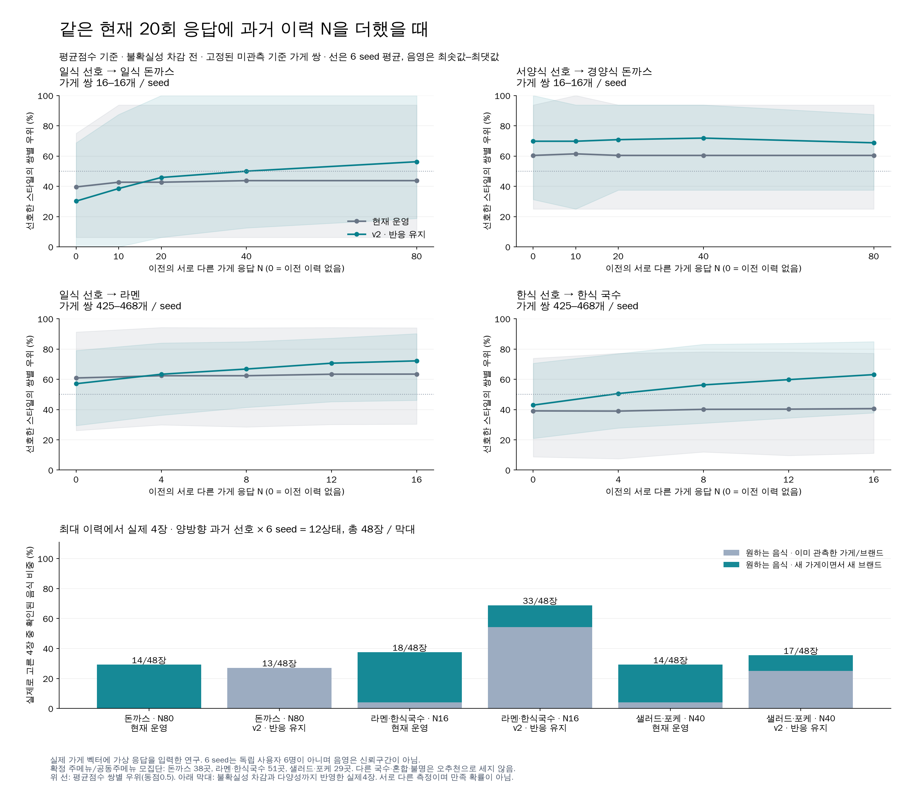
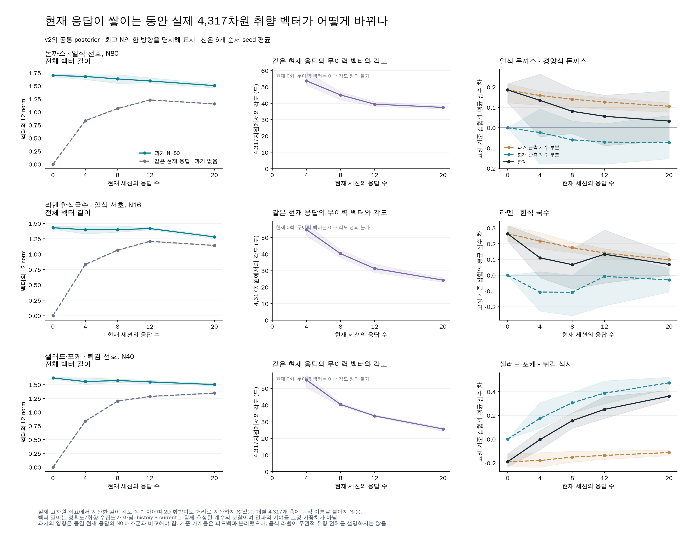
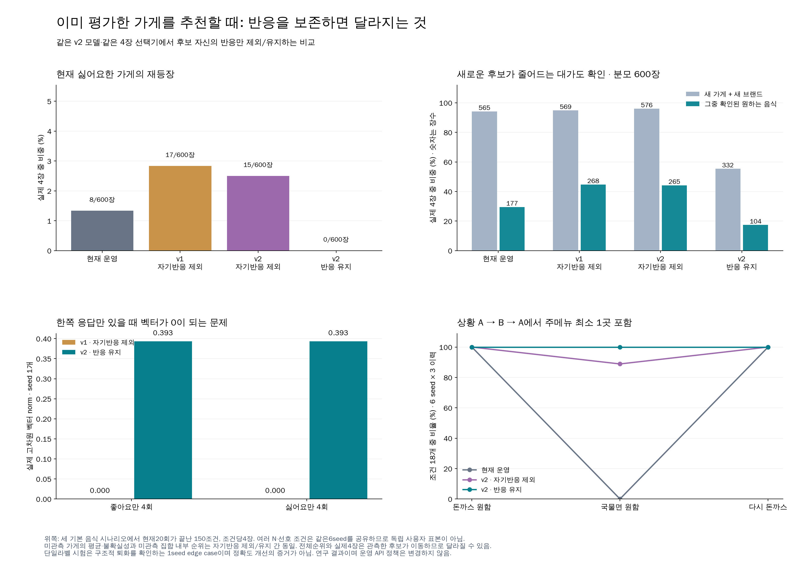
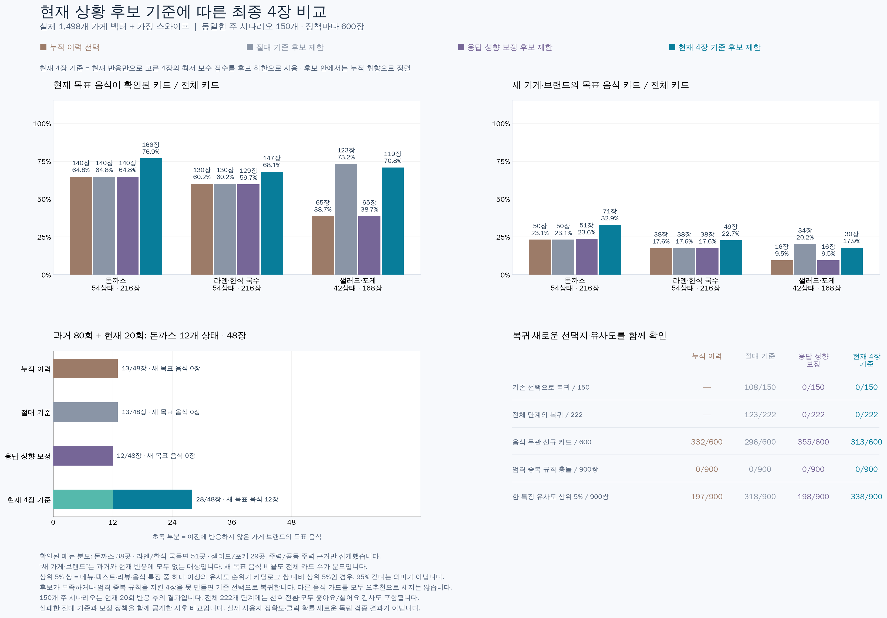

# 과거 이력 N과 현재 추천의 관계

**2026-09-22 해석 정정:** 첫 카드 불변과 아래 `확정 일식 2→2장` 비교만으로 과거의
미세 취향 효과가 없다고 판단할 수 없다. 후자는 같은 과거에서 선택기만 바꾼 비교다.
현재와 선택기를 고정하고 과거만 바꾼 재분석에서는 점수·상위 순위·최종 네 장이 달라졌다.
원래 측정값은 보존하며, 사용자 요구에 맞는 판정과 실제 선택 손실 지점은
[미세 취향 감사](../nuance_audit/README.md)에 정리했다.

실제 추천 가능한 **1,498곳**의 콘텐츠 유사도로 만든 **4,317차원 잠재공간**에,
음식·스타일 조건을 명시한 가정 반응을 입력한 연구다. 실제 사용자 186명의 시험이나
만족 확률 검증은 아니다. 연구 코드와 결과를 저장하며 운영 API·클라이언트·추천 모델은
교체하지 않는다.
거리·가격 등의 추가 필터 없이 전체 추천 카탈로그에서 기본 4장을 고르는 조건이다.
사용자별 필터를 적용한 실제 가용 가게 수는 이 실험의 1,498곳과 달라질 수 있다.

## 무엇을 고정하고 비교했나

| 현재 상황 | 과거 가게 수 N | 경로 | 측정 상태 |
|---|---|---:|---:|
| 돈까스, 과거 일식/양식 선호 | 0·10·20·40·80 | 54 | 270 |
| 라멘·한식 국물면, 과거 일식/한식 선호 | 0·4·8·12·16 | 54 | 270 |
| 샐러드·포케, 과거 튀김/반대 선호 | 0·10·20·40 | 42 | 210 |
| 돈까스, 완만한 과거 선호 | 40 | 12 | 60 |
| 좋아요만 / 싫어요만 4회 | 0·20 | 6 | 12 |
| 돈까스 → 면 → 돈까스 복귀 | 0·16 | 18 | 126 |
| 합계 | | **186** | **948** |

N은 세션 수가 아니라 과거에 반응한 서로 다른 가게 수다.
동일 seed 안에서 현재 반응의 가게·순서를 고정하고 과거만 바꾼다. N이 작아지면
동일한 최대 이력의 **최근 N개**를 남긴다. 반대 선호는 같은 과거 가게의 반응을 뒤집는다.
기본 시나리오의 현재 20회 중 좋아요는 돈까스·국물면 각각 4회, 샐러드는 6회다.
이는 명확한 상황을 검증하기 위한 입력이며, 보통 사용자의 자연스러운 반응 비율을
대표하지 않는다. 단일 반응 검사는 한 seed의 기능 검사다.

기본 150개 경로는 현재 0·4·8·12·20회 시점에 측정한다. 전환 경로는 동일 8곳을
24회 재평가하며 마지막 반응으로 갱신한다. 세션 구분을 추가해도 새 모델의 시간·계수는
초기화되지 않는다. 시간은 경과한 날짜가 아니라 유효한 스와이프 순서다.

음식 정답을 과거 이력으로 몰래 학습하지 않도록 메뉴명·설명·수집 리뷰까지 검사했다.
그 결과 국물면의 순수 과거 스타일 이력은 최대 16곳까지만 확보됐다. 같은 가게를
반복해 N을 부풀리지 않았다. 과거·현재·고정 비교군은 확인된 브랜드도 분리했다.
새 이력 fixture 독립 검사 1,173개를 통과했다.

## 가게 수와 추천률의 의미

| 감사 범위 | 주력/공동 주력 가게 | 세부 스타일 확정 |
|---|---:|---|
| 돈까스 | 38 | 일식 6, 경양식 6, 혼합 6, 미확정 20 |
| 라멘·한식 국물면 | 51 | 일식 20, 한식 28, 혼합 3 |
| 샐러드·포케 | 29 | 스타일 구분을 사용하지 않음 |

국물면 집합은 모든 국수를 뜻하지 않는다. 우동·쌀국수·짬뽕·냉면·파스타 등은
이번 비교 범위 밖이며 오추천으로 단정하지 않는다. 메뉴 근거 없음도 실제 미판매의
증거가 아니다. 혼합·보조 메뉴·불명확한 곳은 주력 음식 성공에 합산하지 않았다.

- **카드 포함 비율**: 해당 음식/스타일 카드 수 ÷ 실제 반환한 4장.
- **새 가게 회수 비율**: 카드 또는 상위 20곳에 든 해당 새 가게 수 ÷ 해당 음식/스타일의
  미관측 가게·브랜드 전체 수. 예를 들어 `15/34`는 새 돈까스 34곳 중 15곳이 상위 20에
  포함됐다는 뜻이다. 상위 20의 75%라는 비율과 분모가 다르다.
- **스타일 쌍별 우위**: 고정된 미학습 A군×B군의 모든 가게 쌍에서 A가 더 높은 비율.
  동점은 0.5로 센다. 각 seed의 비율을 평균하며, 카드 비율이나 만족 확률이 아니다.
- 전체 미관측 모집단은 N에 따라 바뀔 수 있지만 스타일 비교군은 최대 N에서 사용된
  브랜드까지 제외하고 고정한다. 둘의 분모를 바꾸어 쓰지 않는다.

## 측정된 취향 전달과 실패 방향

같은 현재 20회 반응의 과거 없음(N=0)과 최대 N을 비교했다. 아래는 평균 점수 기준이며,
불확실성을 차감한 순위와 구분한다. 각 행은 6개 입력 순서 seed의 평균이다.

| 과거 → 현재의 세부 스타일 | N=0 쌍별 우위 | 최대 N 쌍별 우위 | 변화 |
|---|---:|---:|---:|
| 일식 → 일식 돈까스, N=80 | 30.21% | 56.25% | +26.04%p |
| 양식 → 경양식 돈까스, N=80 | 69.79% | 68.75% | **−1.04%p** |
| 일식 → 라멘, N=16 | 57.07% | 72.17% | +15.10%p |
| 한식 → 한식 국물면, N=16 | 42.93% | 63.09% | +20.16%p |

경양식 N=80은 6개 중 3개 seed에서 악화됐다. 예를 들어
`cutlet-103-n80-western`은 경양식 쌍별 우위가 N=0보다 12.5%p 낮았다.
벡터가 움직였다는 사실만으로 원하는 세부 취향이 잘 전달됐다고 해석하면 안 된다.
다만 경양식 평균 점수 차이는 자기 방향으로 +0.0288 이동했고 5/6 seed에서 같은
방향이었다. 쌍별 우위의 −1.04%p는 고정 6×16쌍에서 순우위 1쌍 차이다. 이 쌍들은
독립 표본이 아니다. 이를 전체 취향 전달 실패로 확대하지 않고 연속 차이와 함께 본다.



## 실벡터 값과 해석

개별 좌표는 메뉴·설명·리뷰·음식 사진 유사도의 스펙트럼 좌표다. `menu:123` 같은
번호는 출처와 축 번호이지 ‘매운맛’·‘일식’이라는 의미가 아니다. 좌표값은 같은 기저에서
내보내고, 길이·각도·거리와 고정 기준 가게의 점수 차이를 함께 본다.

| 원천 유사도 | 근거가 있는 가게 | 만든 잠재 축 | 제거한 음의 스펙트럼 질량 비율 |
|---|---:|---:|---:|
| 메뉴 | 1,498 | 1,164 | 3.968% |
| 설명 | 1,497 | 1,151 | 0.154% |
| 리뷰 | 1,472 | 1,079 | 0.454% |
| 음식 사진 | 1,394 | 923 | 0.626% |

원본 임베딩 좌표를 그대로 복사한 것이 아니라, 중심화한 유사도를 양의 스펙트럼으로
근사한 공간이다. 아래 점수 재구성 오차가 작다는 것은 **이 모델 내부 계산이 일치한다**는
뜻이지, 원본 의미 정보가 모두 보존됐거나 추천 정확도가 높다는 증거는 아니다.

`cutlet-100-n40-japanese`, 현재 20회, 개선 모델의 실제 예:

| 수치 | 값 | 의미 |
|---|---:|---|
| 전체 벡터 길이 | 1.377177 | 계수의 L2 크기. 정확도나 취향 수집도가 아님 |
| 같은 현재 반응의 N=0 벡터 길이 | 1.154577 | 과거만 제거한 대조군 |
| N=0과 벡터 거리 / 각도 | 0.700834 / 30.556° | 전체 4,317차원에서 계산한 과거 추가 효과 |
| 일식 4곳−경양식 4곳 평균 점수 차 | +0.023008 | 이 고정 비교군에서는 일식 평균이 약간 높음 |
| 과거 관측 계수 부분 / 현재 부분 | +0.100756 / −0.077747 | 두 부분을 합하면 위 점수 차. 인과 기여율은 아님 |

지속·최근 상황 성분을 합한 벡터와 절편으로 모델의 공통 평균 점수를 재구성했다.
948개 상태의 최대 오차는 **8.33×10⁻¹⁶**이었다. 후보 자신의 반응을 제외하는 계산은
이미 반응한 후보마다 별도 사후분포를 가지므로, 공통 벡터 하나로 그 모든 LOO 점수를
설명하지 않는다. 미관측 후보와 전체 사후 예측은 공통 벡터로 설명된다.



## 수정한 문제와 효과를 과장하지 않은 부분

1. 자유 절편이 좋아요만/싫어요만인 반응을 모두 흡수해 취향 벡터가 0이 되는 문제를
   수정했다. 기존 관측 잡음 분산 R을 이용한 유한 절편 사전분포 `b ~ N(0,R)`를
   추가하고 나머지 커널 매개변수는 유지했다. 실제 같은 가게 4곳에 한 종류 반응만
   주면 v1 벡터 길이는 0, 개선 후보는 0.393338이다. 이는 학습 가능성 수정이며
   정확도 39.3%라는 뜻이 아니다.
2. 자기 반응을 제외하는 LOO는 예측 검증용 비교군으로 남기고, 실제 연구 후보의
   추천에는 알려준 반응을 유지한다. 미관측 가게의 평균·표준편차는 두 계산에서
   정확히 같지만, 이미 좋아요한 가게를 다시 추천하는 것은 일반화 성공으로 세지 않는다.
3. 브랜드 별칭을 통합해 미관측 분모를 수정했다. BHC의 다른 표기를 별개 브랜드로
   세면 샐러드 32개 최종 사례의 미관측 전체 분모가 1씩 과대 계산됐다.
4. 음식/리뷰 원본·행렬·모델·선택기 코드를 실행 전후 해시로 검증한다. 원본이 실행 중
   바뀌면 결과를 확정하지 않는다. 스냅샷도 v1/v2를 구분해 서로 잘못 복원하지 않는다.

현재 20회 기본 150조건에서 운영과 전체 사후 예측 후보 모두 원하는 음식이 최소
한 장 포함됐다(150/150). 포함 여부 우위는 없다. 원하는 음식 카드는 운영 193/600장,
전체 사후 예측 후보 335/600장이지만, 그중 **새 가게·브랜드의 음식 카드는 177→104장**이다.
이미 알려준 좋아요 재추천이 상당 부분을 차지한다.

같은 개선 모델에서 LOO 추천과 전체 사후 예측을 비교하면 현재 싫어요 재등장은
15→0/600장, 전체 새 가게 카드는 576→332/600장이다. 이 양면을 함께 평가해야 한다.



기존 실제 로그 2,001건·61세션·10명의 응답 전 예측에서는 세션 평균 AUC가
v1 0.56607→유한 절편 후보 0.56389였다. 사용자 단위 bootstrap 95% 차이 구간은
−0.01515~+0.00481로 0을 포함한다. 전체 예측력이 개선됐다고 주장하지 않는다.
선택기에서 양수 적합도 조건을 단순 제거한 다른 개발 실험은 원하는 음식 카드를
줄였으므로 채택하지 않았다([수치](development-ablation.json)).

## 과거가 오늘의 음식을 밀어내는 선택 단계

최초 N 실험에서 돈까스 N=80의 12개 조건은 48장 중 돈까스가 13장뿐이었고,
새 돈까스는 0장이었다. 과거 일식 방향의 벡터가 좋아져도 마지막 선택기가 과거의
다른 음식 좋아요를 다시 고르면 오늘 상황을 충분히 보존하지 못했다.

현재 반응으로 적격 범위를 정하고, 그 안은 누적 이력과 현재를 함께 학습한 점수로
정렬하는 방식을 비교했다. 음식/업종 정답을 모델에 입력하거나 과거를 고정 %로
제한하지 않는다. 모든 비교에서 전체 사후 예측의 벡터·평균·표준편차는 같으며
**후보 선택만 다르다**. 반환 장수는 기존 config.count를 따른다.

첫 두 비교는 원하는 문제를 해결하지 못했다.

- **절대 원점**: 현재 평균>0 및 기존 상위 분위 조건을 사용했다. 개발 198상태에서는
  목표 음식 366→477/792장, 새 목표 음식 97→139장으로 좋아 보였다. 그러나 확장된
  기본 150조건에서는 개선 58장이 전부 샐러드에만 나타났다. 돈까스·국물면 108조건은
  적격 가게 부족 또는 기존 선택기의 다양성 조건 때문에 전부 원래 방식으로 복귀했다.
- **공통 절편을 뺀 원점**: `μ_current−b_current=Xw_current`로 현재 취향 자체의
  원점을 사용했다. 순위와 상위 분위 관계는 유지되지만 적격 집합이 374~375곳으로
  넓어졌다. 기본 150조건 모두 필터를 적용해도 목표 음식은 335→334/600장,
  돈까스 N=80은 13→12/48장으로 줄었다. 적용률이 높다는 이유로 채택하지 않았다.

두 번째 비교의 b는 취향 계수와 함께 추정한 공통 응답 성향이지 좋아요 비율이 아니다.
적격 판정의 표준편차는 기존 현재-only 예측의 값을 유지했으므로 `μ−b`를 별도의 신뢰구간이나
‘기준을 넘을 확률’로 해석하지 않는다. 이 실패도 비교 수치에 남겼다.

후속 비교는 **현재 반응만으로 실제 선택한 n장의 최소 보수 점수**를 하한으로 삼는다.
현재 기준 추천보다 그 하한이 낮은 후보를 제외하고, 나머지를 전체 이력 점수로 정렬한다.
원하는 음식 라벨이나 새 수치 임계값을 넣는 대신 실제 현재 추천 결과를 기준으로 한다.
현재만의 n장 또는 최종 n장이 기존 strict 다양성을 충족하지 못하면 전체 결과로 복귀한다.
현재만의 n장이 적격 집합에 남아 있어 가능한 조합은 존재하지만, 기존 선택기의 제한된
탐색이 그 조합을 찾는다는 보장은 없으므로 복귀 횟수도 별도로 측정한다.

### 같은 입력에서 확인한 선택 개선과 손해

| 기본 150조건, 총 600장 | 누적 점수 선택 | 절대 원점 | 절편 제거 | 현재 추천 하한 |
|---|---:|---:|---:|---:|
| 원하는 음식 | 335 (55.8%) | 393 (65.5%) | 334 (55.7%) | **432 (72.0%)** |
| 새 가게·브랜드의 원하는 음식 | 104 | 122 | 105 | **150** |
| 음식 종류 무관 전체 새 가게 | 332 | 296 | 355 | **313** |
| 원래 선택으로 복귀한 조건 | 해당 없음 | 108 | 0 | **0** |
| 알려진 싫어요 카드 | 0 | 0 | 0 | **0** |
| 한 특징 이상 유사도 상위 5%인 쌍 / 900쌍 | 197 | 318 | 198 | **338** |

현재 추천 하한 방식의 음식별 변화는 돈까스 140→166/216장,
국물면 130→147/216장, 샐러드 65→119/168장이다. 150조건 중 음식 카드가 늘어난
조건은 67개, 같은 조건은 80개, 줄어든 조건은 3개다. 감소는 같은 seed101의
일식 과거 국물면 N=4·8·12에서 각각 1장이다.

문제였던 돈까스 N=80의 12조건은 **13→28/48장(27.1→58.3%)**, 새 돈까스는
**0→12장**, 새 돈까스가 하나 이상 있는 조건은 **0→8/12**가 됐다.
따라서 상황 보존은 개선됐지만 모든 카드가 돈까스가 되거나 세부 스타일이 보장되지는 않는다.
일식 과거의 N=80 6조건은 돈까스 7→11/24장인데 **확정 일식 돈까스는 2→2장**이다.
경양식 과거 6조건은 돈까스 6→17/24장, 확정 경양식 돈까스 4→6장이다.
두 방향 모두 새 스타일 확정 가게는 0장이다. 같은 seed의 과거 선호를 반대로 바꾼
6쌍 모두 첫 추천 가게도 같았다. 현재 음식 보존의 증가를 과거 디테일 전달 성공과
동일시하지 않는다.

위 `2→2`는 선택기 개선 효과의 범위이며 과거 자체의 효과를 측정하지 않는다.
같은 현재에서 반대 과거를 비교하면 첫 가게는 최근 좋아요 1위로 유지되지만 네 장 집합과
top10은 6쌍 모두 달랐다. 첫 카드 반전을 요구하지 않는 해석과 후보 수 차이 검증은
[후속 감사](../nuance_audit/README.md)에 있다.

예를 들어 `cutlet-103-n80-western`은 계몽돈까스2호점·브루클린더버거조인트역삼점·
랩스피자강남본점·프라텔리에서 계몽돈까스2호점·호또치킨·꼬끼꼬끼치킨·카츠쇼신으로
바뀐다. 돈까스가 1→2장으로 늘지만 치킨 2장이 남는다. `cutlet-100-n80-japanese`는
돈까스 1장으로 그대로다. 이 사례들을 성공처럼 숨기지 않았다.

추가 비교 전체 222상태에서 888장의 현재 보수 점수가 기준 4장의 최솟값 이상인 것을
확인했다. 모두 정책을 적용했고 복귀 0건, 기존 strict 충돌 및 동일 브랜드 쌍도 0건이다.
다만 기본 150조건에서 각 카드 묶음의 최대 쌍 유사도 백분위 평균은 **88.8→96.1**로
올랐다. 음식 상황을 좁히는 대신 비슷한 선택지가 늘었으므로, 이를 전체 추천 품질 개선이나
운영 적용 준비 완료로 주장하지 않는다.



이 결과로 **현재 추천 하한을 유지하는 별도 연구 선택기**를 구현하고 재현 가능하게 남겼다.
개별 음식의 강제 할당, 고정 이전 세션 비중, 실험 정답을 사용한 순위 보정은 넣지 않았다.
운영 전환 전에 남은 핵심은 세부 스타일의 양방향 전달과 체감 중복을 함께 개선하는 것이다.


어느 방식도 strict 조건 통과를 사람이 충분히 다르게 느낀다는 보장으로 해석하지 않는다.
최대 모달리티 유사도 백분위의 상위 꼬리도 측정한다. 필터 전후 고정 비교군의 생존 수를
함께 내보내며, 비교군 일부를 제외해 조건부 비율이 높아진 것을 벡터 예측력 개선으로
세지 않는다. 전체 새 가게 노출과 원하는 음식의 새 가게 발견도 구분한다.

## 재현과 결과 범위

```bash
cd BE
OPENBLAS_NUM_THREADS=1 python -m pytest analysis/temporal_taste -q
OPENBLAS_NUM_THREADS=1 python -m analysis.temporal_taste.depth_bench \
  --serving /path/to/kakao/serving \
  --fixtures analysis/temporal_taste/history_depth/scenarios.json \
  --food-audit analysis/temporal_taste/history_depth/food-audit.json \
  --salad-audit analysis/temporal_taste/history_depth/salad-audit.json \
  --output /path/to/offline-results
OPENBLAS_NUM_THREADS=1 python -m analysis.temporal_taste.context_floor_bench \
  --serving /path/to/kakao/serving \
  --fixtures analysis/temporal_taste/history_depth/scenarios.json \
  --food-audit analysis/temporal_taste/history_depth/food-audit.json \
  --salad-audit analysis/temporal_taste/history_depth/salad-audit.json \
  --reference-results /path/to/offline-results/results.json \
  --output /path/to/floor-results.json
```

앞선 두 정책은 같은 인자로 `context_bench`를 실행하며, `--context-origin absolute`
또는 `--context-origin intercept`를 지정한다. 참조 결과를 주면 원래 전체 사후 예측의
실제 카드·점수가 바뀌지 않았는지도 검사한다. 각 실행의 코드·입력 해시는 결과에 남는다.

입력은 가정 반응과 파생 감사 라벨이다. 원본 메뉴·리뷰·서빙 벡터·실제 사용자 기록은
Git에 넣지 않는다. CLI는 서버 부팅/DB 복원을 하지 않고 임시 캐시를 사용한다.
전체 실행 결과는 948상태×4계산=3,792행, 실제 카드 15,168행이다.
모든 시점의 전체 계수와 마지막 시점의 성분 계수는 `preference-vectors.npz`에 내보낸다.
원본 카탈로그 벡터와는 다른, 가정 시나리오로 학습한 계수다.

새 이력 N 사례는 첫 비교의 모델/반응/감사 라벨을 고정한 뒤 측정했다. 이후 이 결과를
보고 만든 개선의 동일 N 재검증은 개선 전후 분석이며, 미열람 최종 검증으로 부르지 않는다.
6개 seed가 가게를 공유하므로 음영은 최솟값~최댓값이며 신뢰구간이 아니다.
현재 선택기의 원점수 양수 조건·불확실성 계수는 점수 단위가 다른 후보에서도 유지한
스트레스 테스트다. API 점수 의미가 호환된다는 보장은 없다.

운영 전환에는 swipe 탐색, decision, 설명/지도, 진행도, 세션 복사, 스냅샷과 legacy
interleave의 정합성 검증이 별도로 필요하다. 이번 결과만으로 취향 점수 함수 하나를
바꾸어 운영 추천이 개선됐다고 보고하지 않는다.

연구 자동 검증은 170개를 통과했다. 222개 비교의 원래 전체 사후 예측 카드·점수·벡터는
동일했고 입력 및 코드 해시는 실행 전후 일치했다. 수치·모집단·하한 보장은 별도 집계로
다시 대조했다. 검증 시점에 병행 병합된 진행 점수 변경은 보존했으며, 측정에 사용한
추천/선택/가게 데이터 코드의 해시에는 변화가 없다.
