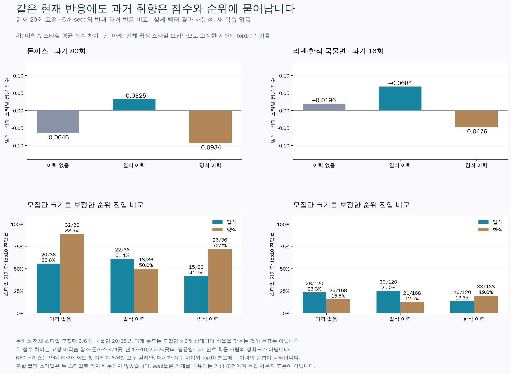
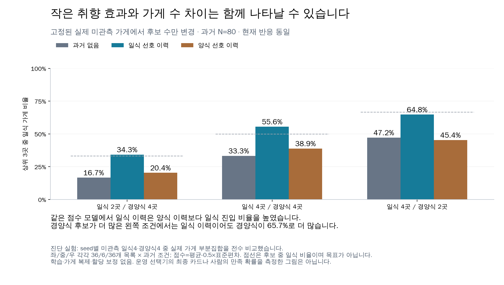
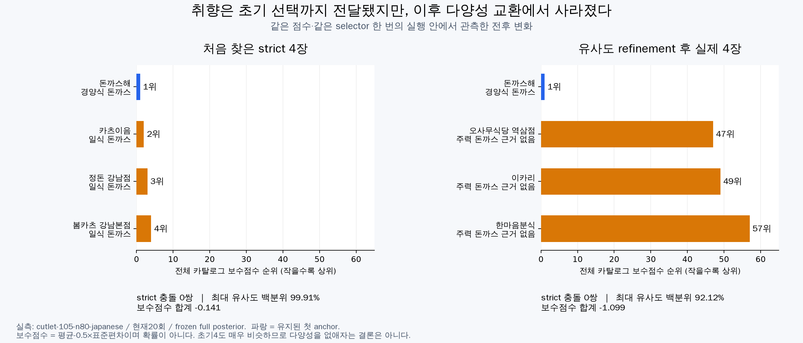

# 현재 상황 안에 과거 취향이 작게 묻어나는가

**기술적으로 가능하며, 고정한 연구 모델에서도 그 방향의 효과가 이미 측정된다.**
앞선 보고는 첫 카드 불변과 선택기 변경 전후의 스타일 카드 수를 과거 취향 전달의
실패 근거처럼 사용했다. 이 해석을 정정한다. 같은 현재 반응에서 과거만 바꾼 비교가
필요하며, 그 비교에서는 연속 점수·상위 순위·최종 네 장 구성이 달라졌다.

또한 실제 손실 지점을 찾았다. 현재의 다양성 추가 교환은 적합도 손실보다 유사도
감소를 우선한다. 연구 점수를 기존 선택기에 넣은 실행에서, 처음 찾은 적합한 조합의
미세 취향 신호가 이 단계에서 약해졌다. 모델이 전혀 배우지 못한 경우와 구분해야 한다.

이번 변경은 **검증·해석 정정**이다. 수치에 맞춘 모델/임계값/카테고리 할당 조정이나
운영 추천 교체는 하지 않았다. 아래는 실제 1,498곳의 데이터와 가정한 반응으로 계산한
결과이며 사람의 만족도, 실제 노출 확률 또는 운영 A/B 결과가 아니다.

## 사용자가 원한 것과 이번 판단 기준

원한 것은 최근 스와이프가 현재 상황을 빠르게 반영하고, 누적 취향이 그 상황에 맞는
후보들의 세부 순위에 작게 남는 추천이다. 세션 경계를 넘을 때 과거를 일정 비율로
제한하지 않으며, 같은 세션에서도 최근 반응이 조금 더 강하게 작용해야 한다.
“5:5에서 3:7”은 가능한 변화의 예이지 합격 비율이나 할당량이 아니다.

따라서 첫 카드 반전, 선호 스타일의 과반, 네 장 모두 같은 음식은 성공 조건이 아니다.
현재 적합도가 비슷한 후보 사이에서 **과거를 바꿨을 때의 점수 차이와 순위 변화**를 본다.
실제 가게 수와 품질 차이도 남겨야 한다. 한 장만 바뀌어도 네 장 비율은 25%p나 움직이므로
한 번의 카드 비율로 작은 취향 효과를 판단하기에는 해상도가 낮다.

앞선 작업은 원본 데이터·가정 반응·브랜드 분리와 수학 검산은 지켰지만,
**성공 여부를 설명하는 기준이 요구와 충분히 맞지 않았다.** 특히 다음 두 해석을 고친다.

- `확정 일식 2→2장`은 같은 과거를 둔 채 선택기만 바꾼 비교다. 과거 유무의 효과를
  검증하지 않는다. 이 측정값 자체는 유지하되, 취향 전달이 없다는 근거로 쓰지 않는다.
- 반대 과거에서도 첫 카드가 같은 6쌍은 현재의 가장 최근 좋아요가 계속 1위인 경우다.
  최근 상황 우선이라는 요구와 양립한다. 네 장 집합과 top10 구성은 6쌍 모두 달랐다.

## 실제로 얼마나 묻어났나

현재 가게·반응·순서를 20회로 고정하고 과거 없음, 일식 선호, 상대 스타일 선호를
비교했다. 반대 이력은 같은 과거 가게들의 반응만 뒤집는다. N은 세션 수가 아니라
과거에 반응한 서로 다른 가게 수다. 각 행은 같은 가게들을 재사용하는 6개 순서 seed다.

| 미학습 가게의 `일식 평균 − 상대 스타일 평균` | 과거 없음 | 일식 과거 | 상대 과거 |
|---|---:|---:|---:|
| 돈까스, 과거 N80 | −0.0646 | +0.0325 | −0.0934 |
| 라멘·한식 국물면, 과거 N16 | +0.0196 | +0.0684 | −0.0476 |

양수는 일식 쪽으로 기운다는 뜻이다. 이 점수는 선호 확률이나 정확도가 아니다.
돈까스는 seed마다 미학습 일식 4곳/경양식 4곳, 면은 17~18곳/25~26곳의 고정 참조군이다.
돈까스에서 일식 과거를 주면 N0 대비 +0.0971, 경양식 과거를 주면 경양식 방향 +0.0288만큼
이동했다. 방향 일치는 각각 6/6, 5/6이었다. N10·20·40 및 완만한 이력도 함께
남겼으며 좋은 최대 N만으로 전체 성공을 주장하지 않는다.

전체 카탈로그에서 계산한 **top10 순위**의 확정 일식/경양식 돈까스 수는
과거 없음 `20/32`, 일식 과거 `22/18`, 경양식 과거 `15/26`이었다.
각 조건은 6회 × 10자리 = 60자리이며 나머지는 혼합·불명 스타일 또는 다른 음식이다.
현재 좋아요 가게를 포함하므로 이것 전체를 새로운 가게에 대한 일반화로 세지 않는다.
미관측 가게·브랜드만 분리한 결과와 분모는 [상세 재분석](nuance-report.md)에 있다.

완만한 이력도 검사했다. 같은 과거 40곳에서 선호군 20곳 중 15곳, 상대군 20곳 중 5곳을
좋아하는 조건이다. 모델의 과거 가중치를 75%로 정한 것이 아니다. 일식 방향 변화는
N0 대비 +0.0641로 6/6 일치했지만, 경양식 방향은 +0.0061로 3/6만 일치했다.
**작은 효과가 존재한다는 결론과, 양방향 모두 안정적이라는 결론은 다르다.**

## 경양식 가게가 많으면 더 많이 나오는가

학습된 점수는 고정하고, 실제 미학습 돈까스 4+4곳에서 가능한 부분집합을 전수 구성했다.
가게 복제, 그룹 가산점, 추천 비율 보정 없이 각 부분집합의 top3를 계산했다.
아래는 기존 순위와 같은 `평균 − 0.5×표준편차` 기준, N80 결과다.

| 실제 후보 일식:경양식 | 과거 없음의 일식 비중 | 일식 과거의 일식 비중 | 경양식 과거의 일식 비중 |
|---|---:|---:|---:|
| 2:4 | 18/108 (16.7%) | 37/108 (34.3%) | 22/108 (20.4%) |
| 4:4 | 6/18 (33.3%) | 10/18 (55.6%) | 7/18 (38.9%) |
| 4:2 | 51/108 (47.2%) | 70/108 (64.8%) | 49/108 (45.4%) |

경양식이 두 배인 후보에서는 **일식 과거가 있어도 경양식이 65.7%**였다.
과거 취향에 따른 작은 기울기와 가게 수에 따른 차이가 함께 나타날 수 있다.
모집단의 비율은 맞춰야 할 목표가 아니며, 개별 가게의 적합도 차이도 남아 있다.

이 표는 실제 가게 6~8곳 안의 단순 top3 진단이다. 전체 1,498곳의 다양성 네 장 추천률이
아니다. N10·20·40·80, 평균/보수 점수를 모두 저장했다. 1,872행 중 N0 반복을 빼면
1,404조건이며, 어느 쪽도 독립 사용자 수가 아니다.

또한 경양식 과거를 추가했는데 N0보다 일식 비중이 늘어난 칸도 있다. 반대 과거 간
방향은 맞더라도 N0 대조가 항상 같은 방향인 것은 아니다. 이를 감추거나 첫 카드가
안 바뀐 문제와 섞지 않는다. 실제 경계를 추적한 seed102에서는 전체 참조 평균이
경양식 쪽으로 이동했어도 시올돈이 계몽돈까스보다 더 크게 올라 top3에 진입했다.
두 가게의 보수 점수 차이는 −0.090190에서 +0.001618로 바뀌었다. 그룹 평균의 작은
방향성과 개별 경계 가게의 역전은 동시에 가능하며, 이 사례에서는 실제로 관측됐다.
어떤 메뉴 특징 때문인지는 이 산술 검사만으로 단정하지 않았다.
[두 반례의 실제 점수·순위](western-boundary-audit.md)를 함께 남긴다.

## 실제로 약해진 지점: 다양성 추가 교환

연구 점수로 기존 선택기를 실행한 9개 대표 상태 × 2정책의 18회를 단계별로 추적했다.
원래 최종 네 장과 적격 후보 수를 18회 모두 정확히 재현했다. 이미 strict 조건을
통과한 조합을 찾은 뒤 `_refine`이 교환하면서 다음 변화가 있었다.

| 18회, 총 72자리 | 처음 찾은 조합 | 다양성 추가 교환 후 |
|---|---:|---:|
| 기존 strict 조건 충돌 | 0 | 0 |
| 주력/공동주력 돈까스 카드 | 71 | 30 |
| 전체 후보에서의 평균 순위 | 3.76위 | 39.82위 |
| 각 네 장의 최대 유사도 백분위 평균 | 99.82% | 86.80% |

대표 사례에서는 `돈까스해·카츠이음·정돈·봄카츠`의 **1·2·3·4위** 조합이
`돈까스해·오사무식당·이카리·한마음분식`의 **1·47·49·57위**로 바뀌었다.
일식 취향이 모델과 초기 조합까지 전달됐지만 이후 선택에서 약해진 것이다.
탐색 예산 고갈과 soft fallback은 이 18회에서 모두 0회였다.

현재 목적 함수는 충돌·브랜드·결측 다음에 유사도를 비교하고, 적합도 순위는 마지막에
비교한다. 상위 후보창 안에서는 미세한 유사도 개선도 큰 적합도 손실보다 먼저 채택된다.
점수 차이의 크기를 직접 고려하지 않는다. [소스](../../../server/recsys/decision.py)의
`_refine`과 [18회 추적 보고서](selector-boundary-report.md)에 근거를 남겼다.

초기 조합도 유사도 백분위가 높았으므로 다양성 교환을 그냥 제거하는 해법은 부적절하다.
해결 방향은 **기존 중복 제한을 지키면서 추가 다양성을 얻기 위해 버리는 적합도를 통제**하는
것이다. 비슷한 적합도의 조합끼리 다양성을 비교하거나, 적합도 손실과 유사도 개선의
교환관계를 직접 평가할 수 있다. 일식 quota나 고정된 이전 세션 비중은 필요하지 않다.
허용 손실을 이번 사례에 맞춰 임의로 정하지 않았으며 이 정책 변경은 아직 구현하지 않았다.

## 기술적으로 되려면 무엇이 필요한가

원하는 효과를 `현재만의 점수 s₀(i)`와 `과거 추가에 따른 변화 δ(i)`로 쓰면,
후보 a가 b를 앞서는 것은 `δ(a)−δ(b)`가 원래 두 후보의 점수 차이를 넘을 때다.
변화가 작으면 가까운 순위만 바뀌고 강한 현재 좋아요의 첫 순위는 유지될 수 있다.
이것은 구현 가능한 순위 문제이며, 모든 추천을 크게 바꿀 필요가 없다.

고차원 값의 의미는 좌표 하나에 '일식'이라는 이름을 붙이는 방식으로 평가하지 않았다.
고정 가게군의 특성 평균 차이와 `w_history−w_no_history`의 내적으로 스타일 점수 이동을
측정했다. 공통 절편은 두 스타일 차이에서 상쇄된다. 고차원 자체가 세부 취향 학습을
보장하지는 않으며, 다른 음식에도 공유되는 세부 특징이 실제 유사도에 남아 있어야 한다.

| 필요한 가설/조건 | 현재 근거 | 더 확인하거나 고칠 부분 |
|---|---|---|
| 현재 상황 안에서도 과거 취향과 연결되는 특징이 있다 | 돈까스·국물면의 고정 미학습군에서 방향성 확인 | 완만한 경양식은 약하고 불안정. 다른 스타일·지역의 미열람 후보에서 재검증 |
| 빠른 변화와 오래 유지되는 경향을 나누는 것이 도움이 된다 | 지속+감쇠 커널로 세션 경계 없이 공동 추정 가능 | '빠른 것=상황, 느린 것=취향'은 가설. 반복·교차 상황의 실제 반응으로 확인 |
| 최근 반응은 조금 더 강하되 과거를 고정 %로 제한하지 않는다 | 연구 모델은 모든 관측을 함께 계산하고 세션 시작으로 초기화하지 않음 | 반감기 10과 지속 사전분산 0.1은 고정 실험 가정이지 검증된 최적값이 아님 |
| 현재에 맞는 세부 대안이 실제로 있다 | 확정 돈까스 일식/경양식 각 6곳, 국물면 20/28곳 확인 | 실제 거리·가격·영업 필터 후 후보가 부족하면 원하는 미세한 이동 자체가 제한됨 |
| 작은 점수 변화가 최종 선택까지 보존된다 | 상위 순위와 네 장은 과거에 따라 변함 | 현재 refinement의 적합도 손실 제어가 필요. 유사도도 함께 검증해야 함 |
| 작은 효과를 측정할 대조와 충분한 관측이 있다 | 같은 현재의 N0/반대 과거 대조와 미학습 분모 분리 | 실제 사용자·시간을 분리한 평가와 후보 가용성 기록으로 선택 편향 점검 |

연구 커널의 최근 성분은 스와이프 한 번이 지날 때 약 0.933배가 된다. 이는 커널의
시간 성분 비율이지 전체 추천에서 과거를 93.3% 반영한다는 뜻이 아니다. 새 관측이
들어오면 과거와 현재의 계수를 함께 다시 추정한다. 따라서 N을 늘렸다고 모든 가게의
상대 순위가 단조롭게 변한다는 보장은 없다. 필요한 N도 이력 수만이 아니라 관련성,
대조 반응, 특징 품질, 후보 수와 현재 점수 차이에 달려 있다.

현재-only 하한 실험은 상황 보존을 확인하기 위한 연구 선택기다. 이를 최종 설계로
채택한다면 같은 연속 스와이프를 세션으로 나누는 방식에 따라 후보가 달라지지 않는지
추가 확인해야 한다. 누적 모델 자체가 세션 경계를 무시한다고 선택 단계까지 자동으로
그 성질을 보장하는 것은 아니다.

장기·단기 선호를 상황에 따라 함께 추정하는 방식은 기존 연구에도 구현돼 있다.
[SLi-Rec, IJCAI 2019](https://www.ijcai.org/proceedings/2019/585)는 시간·내용 정보를
이용해 두 종류의 선호를 적응적으로 결합한다.
[CLSR, WWW 2022](https://arxiv.org/abs/2202.13090)는 직접 라벨이 없는 장기·단기
관심을 구분하기 위해 자기지도 대조를 사용한다. 이는 접근의 기술적 실현 가능성을
뒷받침한다. 해당 논문의 성능을 우리 서비스의 성능으로 가져오거나 더 큰 신경망이
필수라고 결론내리지는 않는다.

## 다음 개선의 합격 기준과 이번 검증 범위

우선순위는 모델을 강하게 만들어 스타일 수를 늘리는 것이 아니라, **현재 적합도와
작은 취향 차이를 보존하면서 다양성을 확보하는 선택**이다. 동일 후보/현재 반응으로
N0·양방향 이력을 비교하고, 현재 적합도 손실·취향 방향 이동·중복·새 가게 발견을
함께 평가해야 한다. 품질이 낮은 가게를 단지 해당 스타일 수를 늘리기 위해 올리지 않는다.
판정 기준을 정한 뒤 미열람 사용자·시점·후보에서 평가해야 하며, 이 개발 사례에 맞춘
가중치의 성과를 최종 검증으로 부르면 안 된다.

운영에는 노출 시각·순서·정책과 반응 기록이 이미 있다. 없는 것으로 가정하지 않았다.
반사실적 실사용 성능을 평가하려면 당시 후보와 필터 조건, 노출 정책이 만든 편향을
추가로 확인해야 한다. 이번 진단에서 새 사용자 로그를 수집하거나 내보내지는 않았다.

- 기존 948상태 및 222개 정책 비교를 고정해 재분석했다. 원본 결과·모델·라벨은 보존했다.
- 전체 후보 점수를 다시 내보낸 54조건은 같은 모델/매개변수/가정 반응을 재생한 것이다.
  원래 기록 1,296개의 평균·표준편차 오차는 0이었다. 별도 수식으로 전체 80,892개 점수를
  검산한 최대 오차는 평균 3.16×10⁻¹⁵, 표준편차 6.66×10⁻¹⁶이었다.
- 밀도 진단 CSV 1,872행 및 모든 요약값을 독립 재계산했다. 새 가게 복제·그룹 보정·
  부분집합별 재학습은 없었다. [독립 감사](independent-density-audit.md)를 함께 남긴다.
- 연구 회귀 검사 **170개 통과**. 기존 입력과 코드 SHA를 확인했다.
- 이 MR에는 보고서·파생 측정값·그래프만 포함한다. 원본 메뉴/리뷰/벡터, 사용자 DB,
  인증 정보는 포함하지 않는다. 연구 모델이 운영에 연결됐다고 보고하지 않는다.

전체 재현 입력과 이전 벡터 결과는 [이력 N 연구](../history_depth/README.md)에 있다.
이번 측정의 원본 해시·범위는 [manifest.json](manifest.json)에, 점수/순위는
[nuance-summary.json](nuance-summary.json), 후보 수 진단은
[density-audit.json](density-audit.json), 선택 단계는
[selector-boundary-summary.json](selector-boundary-summary.json)에 기록했다.
