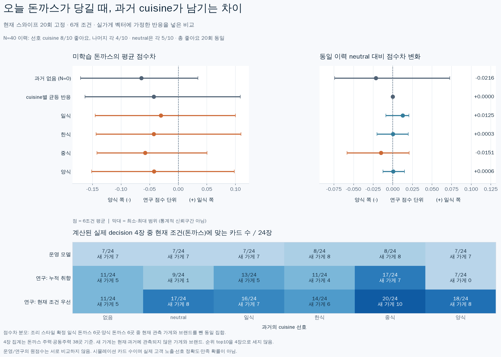
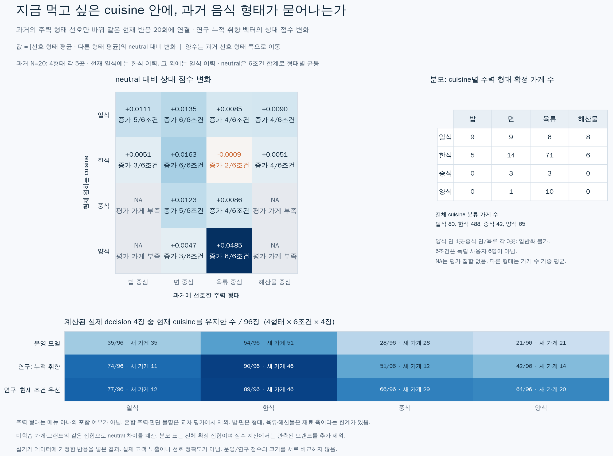

# 현재 상황과 과거 취향의 교차 측정

**과거 취향이 세부 점수와 순위에 작게 남는다는 근거는 확인했다. 모든 취향·최종 네 장에서 일관된 효과가 확인된 것은 아니다.**
같은 현재 반응을 고정하고 과거 반응만 바꾼 180조건을 운영 모델·연구 모델·연구 선택기 세 경로로 재생했다. 실제 반환 카드 2,160장과 전체 후보 점수, 4,317차원 학습 계수를 저장했다. 실제 가게 데이터에 가정 반응을 넣은 통제실험이며 실사용 정확도나 만족 확률은 아니다. 연구 모델과 선택기는 운영 추천에 연결되지 않았다.

발표에서 쓸 수 있는 문장:
> 고정한 연구 모델의 통제실험에서는 같은 현재 반응에서도 누적 취향은 관련 후보 사이의 세부 순위를 조금 바꿀 수 있다. 실가게 벡터를 사용한 통제실험에서 일식 이력은 일식 돈까스 쪽으로, 면 이력은 현재 일식·한식 안의 면요리 쪽으로 점수를 이동시켰다. 변화는 취향 종류와 후보 구성에 따라 달랐으며, 최종 카드에 항상 보존되지는 않았다.

## 돈까스가 당길 때 과거 요리권에 따른 차이

현재 20회(돈까스 좋아요 4회)를 고정했다. 과거는 일식·한식·중식·양식 각 10곳, 총 40곳이다. 특정 요리권 선호 조건은 해당 10곳 중 8곳, 나머지는 각각 4곳에 좋아요한다. 중립 대조는 각각 5곳이다. 모두 총 20번 좋아요하므로 반응량은 같다. 이력 없음도 별도 비교한다. 과거 가게에는 수집 메뉴·설명·리뷰의 돈까스 신호가 없으며 현재/평가 가게와 브랜드도 분리했다.

**아래 점수 표는 연구 모델(누적 취향 GP)의 결과다. 현재 운영 모델의 결과는 그림 하단과 뒤의 별도 비교표에 있다.** 점수는 고정 미학습 일식 돈까스 평균에서 경양식 돈까스 평균을 뺀 값이다. **양수 변화는 일식 쪽 이동**이다. 원점수·변화량은 확률이나 정확도가 아니다. 6조건은 가게를 재사용하는 고정 시나리오이며 독립 사용자 6명이 아니다.

| 과거 선호 | 일식−경양식 평균 점수 | 같은 이력의 중립 대비 변화 | 전체 top10의 일식/경양식 수 |
|---|---:|---:|---:|
| 이력 없음 | -0.0646 | -0.0216 | 20/32 |
| 요리권별 균등 반응 | -0.0430 | +0.0000 | 20/29 |
| 일식 | -0.0305 | +0.0125 | 21/27 |
| 한식 | -0.0427 | +0.0003 | 20/28 |
| 중식 | -0.0581 | -0.0151 | 20/30 |
| 양식 | -0.0425 | +0.0006 | 20/29 |

각 top10 집계는 6회×10=60자리다. 나머지 자리는 다른 음식 또는 스타일 혼합·불명 가게다. 전체 확정 스타일 모집단은 일식/경양식 각각 6곳이고, 점수 대조는 현재 관측 가게·브랜드를 제외한 고정 4곳/4곳이다. 이미 좋아요한 가게가 top10에 들어가는 것은 새로운 가게에 대한 일반화 성공으로 세지 않는다.

- 일식 이력의 이동은 작지만 5/6조건에서 같은 방향이었다. 중립 대비 +0.0125로, 일식이 반드시 과반이 되거나 첫 가게가 바뀌어야 한다는 조건을 두지 않았다.
- 한식 이력은 이 두 돈까스 스타일 사이에서 거의 차이가 없었다. 중식 이력은 경양식 쪽으로 상대 이동했다. 한식/중식 고유 돈까스 스타일의 정답을 임의로 만들어 성공률을 계산하지 않았다.
- 양식 이력은 중립 대비 +0.0006으로 사실상 차이가 작고 3/6조건만 경양식 방향이었다. **양식 이력이 경양식 돈까스를 안정적으로 올렸다는 근거는 이번 비교에서 없다.**



## 밥·면·육류·해산물 선호가 현재 요리권 안에 남는가

현재는 일식·한식·중식·양식 각각의 가게 4곳 좋아요와 다른 요리권 16곳 싫어요로 20회를 고정했다. 이는 현재 요리권이 뚜렷한 통제조건이다. 형태 평가 가게를 남기기 위해 현재 좋아요는 메뉴가 혼합되거나 주력 형태가 확정되지 않은 가게에서 골랐다. 그런 가게가 형태 취향까지 중립이라는 뜻은 아니다.

과거는 형태별 5곳, 총 20곳이다. 선호 형태는 4/5곳, 다른 형태는 각각 2/5곳에 좋아요한다. 중립은 형태별 2곳 또는 3곳으로 두 그룹씩 배분하고 가능한 여섯 조합을 모두 사용해 합산하면 각 형태 15/30으로 같다. 개별 조건이 정확히 50%인 것은 아니다. 모든 조건의 총 좋아요는 10회다.

과거 가게의 요리권은 하나로 고정해 형태와 요리권의 구성 차이가 섞이는 것을 줄였다. 현재 일식에는 한식 이력을, 현재 한식·중식·양식에는 일식 이력을 썼다. 현재 반응과 과거 가게·순서는 비교 조건끼리 동일하며 가정 반응만 바꾼다.

**아래 형태 효과 표 역시 연구 모델의 결과다. 운영 모델의 효과와 동일하다는 뜻이 아니다.** 아래는 **선호 형태의 미학습 가게 평균−다른 주력 형태들의 가게 수 가중 평균**이 중립 이력 대비 얼마나 변했는지다. 다른 요리권의 수치를 직접 비교해 어느 요리권이 더 좋은 모델이라고 판단하는 지표는 아니다.

| 현재 끌리는 요리권 | 밥 선호 | 면 선호 | 육류 선호 | 해산물 선호 |
|---|---:|---:|---:|---:|
| 일식 | +0.0111 (5/6) | +0.0135 (6/6) | +0.0085 (4/6) | +0.0090 (4/6) |
| 한식 | +0.0051 (3/6) | +0.0163 (6/6) | -0.0009 (2/6) | +0.0051 (4/6) |
| 중식 | 평가 근거 부족 | +0.0123 (5/6) | +0.0086 (4/6) | 평가 근거 부족 |
| 양식 | 평가 근거 부족 | +0.0047 (3/6) | +0.0485 (6/6) | 평가 근거 부족 |

괄호는 여섯 고정 조건 중 양수 변화가 나온 수다. 면 선호는 현재 일식·한식에서 모두 6/6조건에 같은 방향으로 남았다. 한식 육류는 평균 −0.0009이고 2/6조건만 양수였다. 측정 가능한 12칸 중 평균 양수는 11칸이지만 **11/12를 정확도·사용자 성공률로 표현하지 않는다.** 현재 운영 모델의 같은 지표는 12칸 중 8칸이 양수였고, 개별 조건의 양수 이동은 운영 35/72·연구 52/72였다. 이것도 통계적 성능 우위 확정이 아니다.



평가 모집단은 일식 밥/면/육류/해산물 9/9/6/8곳, 한식 5/14/71/6곳, 중식 0/3/3/0곳, 양식 0/1/10/0곳이다. 한식의 한 조건은 브랜드 제외로 면13·육류70곳을 사용한다. 양식 면의 6조건은 같은 1가게를 반복 평가하므로 일반화 근거가 약하다.

0은 해당 메뉴를 파는 실제 가게가 없다는 뜻이 아니다. 예를 들어 밥 메뉴가 수집된 가게는 중식 21/42곳, 양식 19/65곳이지만 다른 메뉴도 함께 있어 밥 중심 가게로 확정하지 않았다. 중첩 메뉴 태그는 [별도 보조표](overlap-tags.csv)에 남겼다. 태그 비율은 합쳐 100%가 되지 않으며, 주력 형태 검사와 같은 정답으로 세지 않는다. 한식·중식의 해산물 메뉴 포함 태그에서는 이력 효과가 음수로 나타나 주력 전문점과 같은 결과라고 말할 수 없었다.

실제 과거 표본의 범위도 중요하다. 일식 밥은 초밥/덮밥, 면은 라멘, 육류는 돈카츠, 해산물은 참치/사시미 중심이다. 한식은 국밥/비빔밥/백반, 칼국수, 구이·곱창·족발·닭, 생선탕/해물찜 등의 근거를 사용했다. **이 실제 메뉴 구성으로 쌓인 이력의 전이**이며 모든 곡물·육류·해산물 취향의 순수한 인과 효과가 아니다.

## 실제 순위와 카드에서 나타난 예

미리 고정한 seed100, 현재 한식, 과거 일식 가게들의 면 선호 비교다. 좋은 사례를 골라 전체 성공률을 만드는 대신 전체 180조건 카드도 CSV에 함께 제공한다.

| 가게 | 중립 이력의 미학습 한식 안 순위 | 면 선호 이력 후 |
|---|---:|---:|
| 명동칼국수 | 2위 | 1위 |
| 엄지칼국수 | top10 밖 | 9위 |

누적 취향 연구 모델의 최종 네 장은 다음처럼 바뀌었다. 이는 계산된 실제 selector 반환값이며 예시로 꾸민 화면이 아니다.

| 과거 반응 | 실제 네 장 |
|---|---|
| 중립 | 푸른바다, 선릉순대국, 강남생면우동, 육미당몽산 |
| 면 선호 | 푸른바다, 광양본가, 명동칼국수, 송화냉면 |

같은 seed의 현재 일식에서는 면 선호가 점수와 하위 순위를 바꿔도 최종 네 장은 같았다. 작은 효과가 모든 이산 선택 경계를 넘는 것은 아니다. 조건부 top10을 최종 네 장의 추천률로 대신 보고하지 않았다.

## 벡터값 변화는 무엇을 의미하나

위 한식·면 사례의 실제 4,317차원 계수를 비교했다.

| 수치 | 중립 → 면 선호 | 의미 |
|---|---:|---|
| 벡터 길이 | 1.339604 → 1.345598 | 계수 크기이며 정확도 점수가 아님 |
| 중립 벡터와 거리 / 각도 | 0.317188 / 13.565° | 같은 고차원 기저에서 계산한 전체 변화 |
| 좌표 4312 | −0.111105 → −0.157446 | 실제 좌표 예시. 이 축에 ‘면’이라는 의미를 붙이지 않음 |
| 면−다른 주력 형태 점수 차이 | +0.095619 → +0.104191 | 이 고정 미학습 가게군의 상대 적합도 이동 +0.008572 |

전체 벡터는 다운로드 자료의 `run/predictions.npz`에 저장했다. 좌표값 자체를 음식명으로 해석하지 않고, 고정 가게군의 실제 점수 차이와 내적 관계로 의미를 확인했다. 모든 상태의 벡터로 전체 가게 평균을 재구성한 최대 오차는 5.55×10⁻¹⁶이었다.

## 최종 네 장에서의 현재 상황 보존과 새 가게 발견

180조건×4장=720자리의 실제 반환 결과다. 돈까스 조건에서는 주력/공동주력 돈까스, 나머지는 현재 요리권이 확인된 가게를 센다.

| 재생한 경로 | 현재 조건 가게 | 그중 새로운 가게·브랜드 | 관측된 싫어요 가게 재등장 |
|---|---:|---:|---:|
| 현재 운영 모델 | 253/720 (35.1%) | 248 | 6 |
| 연구: 누적 취향 | 456/720 (63.3%) | 158 | 0 |
| 연구: 현재 적합도 하한 + 누적 취향 순위 | 535/720 (74.3%) | 213 | 0 |

연구 결과의 상당 부분은 이미 좋아요한 가게 재추천이다. 따라서 현재 조건 카드 증가 전체를 새로운 취향 일반화나 신규 가게 발견 개선이라고 부르면 안 된다. 현재 하한 선택기는 이번에도 모든 180조건에 적용됐지만, 누적 취향 모델과 학습 점수는 같고 후보 선택만 바뀐다. 별도의 학습 개선 두 건으로 세지 않는다.

운영 비교는 동일 가정 반응으로 `taste.start_from(taste.replay(past)) → current record → decision.recommend`를 재생했다. 기본 수동 결정 4장, 거리·필터·트렌드 보정·이전 거절 목록 없는 조건이다. 실제 API 응답 포장·진행도·사용자 세션 DB·노출 정책의 A/B 시험은 아니다. 운영 코드의 자동 제안 준비도를 검증했다는 뜻도 아니다.

## 이번 결과로 말할 수 있는 범위

- 현재 반응을 유지하면서 과거 취향이 작은 점수·순위 차이로 남는 계산은 가능하고, 이번 일식 돈까스와 면 전이에서 구체적으로 관측됐다.
- 양식 이력→경양식 돈까스는 이번 균형 비교에서 안정적인 효과가 없었다. 한식 육류 및 여러 조건의 반대 방향을 숨기지 않았다.
- 표본 구성과 메뉴 정의에 따라 효과가 달라진다. 중첩 메뉴 태그는 주력 형태 검사와 다른 질문이다. 빈 셀과 작은 표본은 데이터의 측정 한계다.
- 과거 비중을 고정 비율로 바꾸거나 원하는 카드 비율이 나오도록 모델·선택기·라벨을 조정하지 않았다. 측정 결과를 본 뒤 사례를 갈아 끼우지 않았다.
- 앞선 감사에서 확인한 다양성 추가 교환의 적합도 손실은 별도의 개선 과제다. 작은 점수 효과가 최종 카드에 잘 남도록 하려면 그 손실을 제어하면서 실제 다양성도 함께 검증해야 한다. 이번 요청에서는 측정 코드와 자료만 추가했다.

## 검증과 자료 사용

연구 테스트 181개 통과. 180조건 입력은 점수 계산 전에 독립 검증했다. 실제 카드 2,160장과 평균·불확실성·그룹 분모·순위·중립 대비 차이를 별도 코드로 다시 계산했다. 기존 돈까스 이력 없음 6조건×1,498곳의 평균·불확실성은 이전 결과와 비트 단위로 일치했다. 원본/코드 SHA와 최종 검산 결과는 [result-audit.json](result-audit.json)에 있다.

조건부 top10은 현재 하한 필터 때문에 실제 길이가 10보다 짧을 수 있다. CSV의 `actual_*_slots`가 실제 분모다. 그룹의 `population_slots`는 해당 가게 수를 조건별 합산한 모집단 분모이며 추천 슬롯 수와 다르다.

- [돈까스 비교 CSV](cutlet-comparison.csv): 이력별 점수·변화·실제 카드·분모.
- [형태 비교 CSV](form-comparison.csv): 현재 요리권×과거 형태의 중립 대조·순위·실제 카드.
- [실제 카드 2,160장 CSV](actual-cards.csv): 모든 조건의 가게명·점수·전체 순위·관측 여부.
- [중첩 메뉴 태그 보조 CSV](overlap-tags.csv): 메뉴 존재와 주력 형태를 구분한 추가 기술통계.
- [그림 SVG: 돈까스](matrix-cutlet.svg) · [그림 SVG: 형태](matrix-forms.svg): 발표에서 확대 가능한 원본.
- [재현 입력](fixtures.json)과 아래 CLI: 원본 메뉴·리뷰·카탈로그 벡터·사용자 DB는 Git에 포함하지 않는다.

```bash
cd BE
OPENBLAS_NUM_THREADS=1 python -m pytest analysis/temporal_taste -q
OPENBLAS_NUM_THREADS=1 python -m analysis.temporal_taste.matrix_bench \
  --serving /path/to/kakao/serving \
  --fixtures analysis/temporal_taste/preference_matrix/fixtures.json \
  --output /path/to/offline-results
```

입력은 해당 카탈로그·메뉴 감사·가정 반응의 해시를 고정한다. 재현 환경에서는 fixture에 기록된 원천 경로에 같은 자료가 있어야 하며, 경로를 이식하더라도 실제 파일 해시는 일치해야 한다. 자료 다운로드에는 전체 결과·학습 계수·집계/그림 스크립트를 제공하고 원본 사적 데이터는 제외한다.

측정 기준 코드는 `f287fa4`다. 작업 중 병합된 `2c861de`의 리뷰 수 표시 변경도 보존했다. 추천 모듈에서는 사용하지 않는 `review_count` 함수만 추가됐고 기존 store 문장과 다른 추천 모듈이 같음을 AST/파일 비교로 확인했다([호환 검증](master-compatibility.json)).
