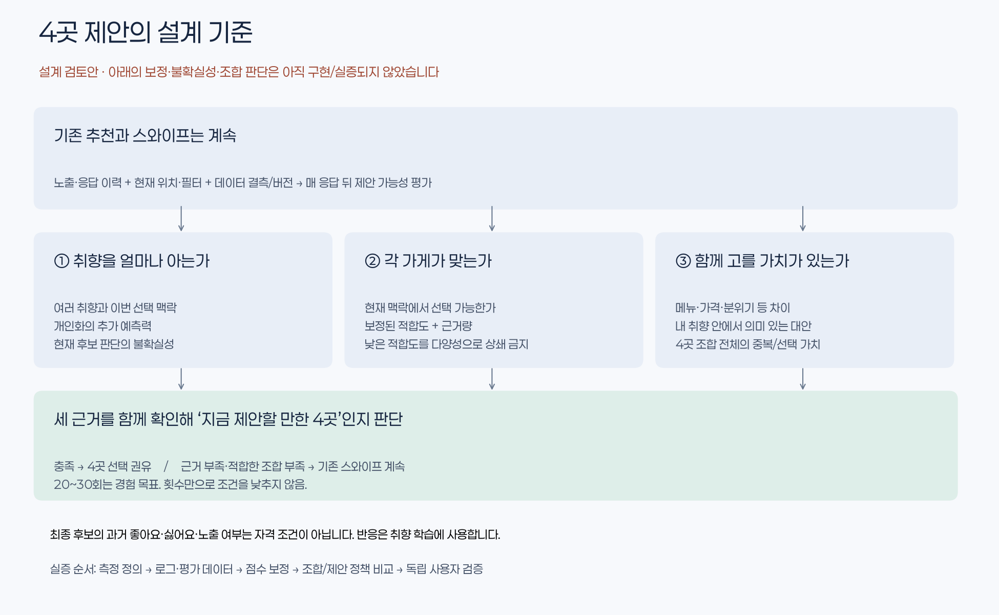
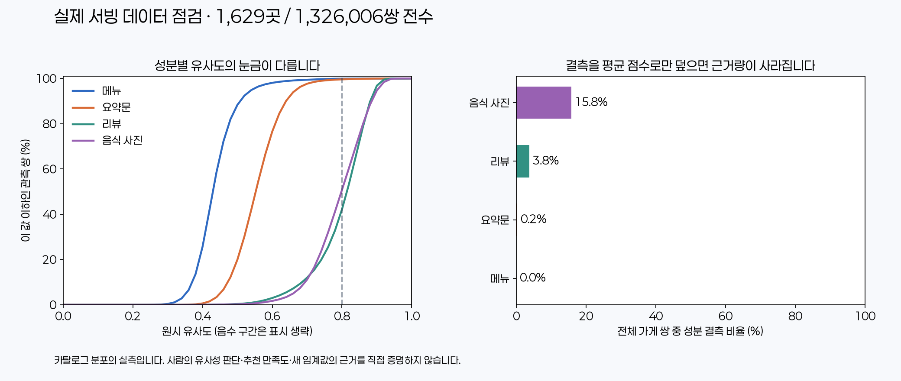

# 4곳 선택 제안: 설계 재검토

2026-09-14. 상태: **기존 구현은 실험용 휴리스틱이다. 세 조건의 제품 타당성을 충분히 검증한 설계가 아니다.**
이 문서는 코드·기존 백테스트·현재 데이터의 대조 결과와 다음 구현이 지켜야 할 설계 계약이다.
새 설계를 구현하거나 실제 사용자 검증을 완료했다는 보고가 아니다. 임계값을 추가 조정하지 않았다.

## 1. 고정된 요구와 아직 정하지 못한 판단 기준

- 기존 추천·스와이프를 지속한다. 선택 제안은 그 위에서 실행되는 별도의 판단이다.
- 취향에 맞는 가게가 충분히 있고, 그 안에서 충분히 다른 **4곳**을 구성할 수 있을 때 권유한다.
- 최종 후보의 좋아요·싫어요·기노출 여부는 자격 조건이 아니다. 과거 반응은 취향 추정에 사용한다.
- 20회 안팎~30회는 사용자 노력의 목표다. 30회가 되었다는 사실이 적합도나 다양성을 증명하지 않는다.
- 적합한 네 곳을 제안하는 것이 목표다. 한 곳만 좋고 나머지는 다양한 조합으로 목표를 바꾸지 않는다.

**4곳과 목표 횟수는 사용자 요구다.** 반면 16개 평가, 양·음 각 3개, AUC .80, 상위20 유지율 .60,
상위25%, 불확실성 계수 .5, 메뉴 .85, 평균 .80, 탐색60은 제품에서 도출·보정된 값이 아니다.
같은 세부 업종 금지도 사용자가 지정한 조건이 아니라 캡처를 보고 추가한 가정이다.
숫자를 설정 파일에 모았다는 사실은 근거가 되지 않는다.

## 2. 현재 시스템에서 재사용할 근거와 새로 필요한 근거

| 현재 자산 | 실제 근거 | 이번 목표에서 부족한 것 |
|---|---|---|
| 인기·평판·공방문·메뉴·요약문 블렌드 | 기존 방문/별점 백테스트, 성분 제거 실험 | 방문 순위 정확도는 '지금 고를 네 곳 모두 적합'의 검증이 아님 |
| 개인별 8개 성분 가중치, 쌍대 로지스틱 갱신 | 온라인 학습 구현과 재생 일관성 | 비교 우위 점수를 개별 가게의 수락 확률로 해석할 수 없음 |
| 대각 가우시안 근사 m/v | 온라인 갱신을 위한 모델 내부 근사 | 실제 예측 오차에 보정된 확률/신뢰구간이 아님. 사전 표준편차 .5도 추정값이 아님 |
| 메뉴 max·요약 lse 등 이력 집계 | 여러 좋아요와 유사한 후보를 포착할 수 있음 | 여러 취향의 비중·이번 목적·각 취향별 근거량을 명시적으로 추정하지 않음 |
| 최대 5개 취향 프로토타입 | 좋아요 군집을 설명하는 화면용 계산 | 취향 군집별 예측 모델이나 불확실성 추정으로 연결되지 않음 |
| 인터리빙 추천 정책 | 기존/신규 정책의 노출·반응을 비교할 구조 | 네 장 제안의 수락, 비교, 최종 선택, 거절 원인이 없음 |
| 앱의 초기10+추가50장 선조회 | 실제 앱 경로와 HTTP 재생 확인 | 피드백 후 다음 노출의 적응이 늦음. 판정기를 붙이는 것만으로 해결되지 않음 |

근거 파일: [기존 분석 설계](../analysis/PLAN.md),
[사전값의 출처](../analysis/backtest/results/step3a-final-spec.md),
[성분 계산](recsys/content.py), [개인화 학습 및 설명](recsys/taste.py),
[현재 제안 구현](recsys/decision.py), [앱 선조회](../../FE/app/lib/screens/home_screen.dart).
과거 분석 문서의 2,216곳과 **현재 로드한 서빙 풀 1,629곳**도 구분한다.

## 3. 세 판단의 현재 결함

### 가게 간 다양성

현재 풀의 중복 없는 모든 쌍 **1,326,006개**를 조사했다. 대각선은 제외했고 사용자 필터는 적용하지 않았다.
각 성분은 값이 관측된 쌍을 분모로 한다. 이는 카탈로그 기술 통계이며 인간의 유사성 정답은 아니다.

| 성분 | 관측 유사도 중앙값 | 관측 쌍 중 유사도 ≥ .80 | 전체 쌍 중 결측 |
|---|---:|---:|---:|
| 메뉴 | .430 | 0.096% | 0.0% |
| 요약문 | .552 | 0.401% | 0.2% |
| 리뷰 | .814 | 57.818% | 3.8% |
| 음식 사진 | .798 | 49.213% | 15.8% |

원시 점수의 위치와 분포가 다르다. 단순 평균은 서로 다른 의미와 눈금을 섞는다.
현재 평균 .80 규칙만으로 배제되는 쌍은 알려진 성분이 2개 이상인 1,325,738쌍 중 1,893쌍이다.
이 비율은 임계값의 작동 범위를 보여줄 뿐, 너무 엄격하거나 느슨하다는 인간 판단을 대신하지 않는다.

세부 업종은 468/1,629곳(28.7%)이 비어 있다. 동일 업종 금지는 라벨이 있는 가게에만 작동한다.
같은 업종에서도 가격·메뉴·이용 목적이 다른 좋은 대안이 있을 수 있고, 다른 업종 이름에도 비슷한
선택이 있을 수 있다. 브랜드도 자동 추출 키의 오류 가능성을 갖는다. 브랜드/업종 정책과 의미적 중복은
따로 검증해야 한다. 결측은 '다름'이 아니라 '근거 부족'이다.

### 취향 적합도

상위25%는 **상대 순위**다. 전체 후보가 별로인 경우에도 상대적으로 높은 후보는 생긴다.
현재의 양수 개인화 기여 역시 '고를 만하다'의 절대 기준이 아니다. 인기·평판을 제외한 점수는
개인적 신호를 진단하는 데 쓸 수 있으나 가게 전체의 이용 가치를 대신하지 않는다.
기존 분석에서 평판은 만족 측면의 근거가 있었다. 개인화의 추가 효과와 기본 품질은 나누어 평가해야 한다.

`_scores(loo=True)`는 후보 자신의 like/dislike를 **유사도 집계에서만** 제외한다.
`m/v`는 해당 반응을 포함해 학습된 상태다. 완전한 leave-one-out 재학습이나 독립 예측이 아니다.
알고 있는 반응을 추천에 쓰는 것 자체는 정상이다. 다만 이런 채점을 독립 검증이나 누출 제거 완료로
설명해서는 안 된다. 과거 답변 전 예측 평가와, 현재 최선의 정보를 쓰는 후보 추정은 목적이 다르다.

### 충분한 개인화

상위20 유지율은 변화량이지 정확도나 개인화의 추가 가치가 아니다. 틀린 순위·좁은 노출·정보 없는
모델도 안정적일 수 있다. 최근 서로 다른 모델 시점의 순위로 계산한 AUC는 노출된 카드에서의 진단이다.
양·음 각3건, 매 응답 반복 검사, 노출 편향을 고려하면 .80을 확신의 수준으로 해석할 수 없다.

`v`는 가중치별 대각 근사다. 공유 반응으로 만든 여러 비교쌍의 의존성, 성분 간 상관,
변하는 이력 집계·정규화, 특징 결측, 취향 변화까지 포괄하는 불확실성이 아니다.
`score - .5 * sd`를 통계적으로 보장된 적합도 하한으로 부를 근거가 없다.
전부 좋아요/싫어요인 경우도 관심이 넓음·노출이 부적절함·응답 성향 등을 구분해야 하며,
라벨 종류 수만으로 개인화 가능성을 확정할 수 없다.

## 4. 설계 계약: 사람 → 가게 → 네 곳 조합을 연결

목표는 사용자의 모든 취향을 완전히 알아내는 것이 아니라 **현재 맥락의 네 곳을 충분한 근거로 제안**하는 것이다.
단, 후보가 안정됐다는 이유만으로 충분한 개인화를 대체하지 않는다. 사용자 정보가 예측에 실제로 기여하는지와
그 네 곳 판단의 불확실성을 함께 확인한다.

| 판단 | 정의할 출력 | 근거와 검증 |
|---|---|---|
| 사용자 상태 | 취향별 선호·기피 근거, 현재 맥락, 알려진/모르는 영역 | 개인화 없는 기준 대비 이후 반응 예측의 개선, 취향별 근거량, 시간에 따른 변화 |
| 가게 적합도 | 이번 맥락에서 고려할 만한 가게인지에 대한 예측과 불확실성 | 응답 전 예측→이후 반응, 별도의 적합성 판단, 실제 선택 결과. 순위와 확률 보정을 따로 평가 |
| 가게 쌍 차이 | 어떤 축에서 비슷하고 다른지, 그 근거의 신뢰도 | 메뉴·가격·분위기·거리/목적 등 축별 자료 및 사람의 쌍 비교. 결측·출처·모델 버전 유지 |
| 네 곳의 가치 | 각 가게의 적합성, 가장 겹치는 쌍, 서로 다른 유효 대안의 범위 | 조합 단위 평가. 모든 쌍의 평균만으로 거의 동일한 한 쌍을 숨기지 않음 |
| 제안 시점 | 지금 제안할 근거, 보류 사유, 추가 반응으로 개선될 여지 | 최초 제안 품질·잘못된 권유·노력·미제안. 세 근거 중 하나가 부족하면 계속 |

가게의 차이에는 공통 의미(메뉴·가격·분위기 등)와 사용자/현재 목적에 따른 중요도가 모두 있다.
사용자별 자료가 적으면 취향별 다양성 가중치를 무리하게 학습하지 않는다. 공통 판단의 불확실성을 유지하고,
충분한 근거가 생긴 부분만 개인화한다. 가격·동행·목적 같은 값은 **이미 수집된 것으로 가정하지 않는다**.
위치·저장 필터 등 현재 가용 정보부터 쓰고, 없는 맥락은 unknown으로 남긴다.

예를 들어 초밥을 좋아하는 사람에게 가격·스타일이 다른 초밥집들은 의미 있는 대안일 수 있다.
한식·카페·술집·디저트를 하나씩 넣어 업종 다양성을 얻어도 이번 식사 선택에 부적합할 수 있다.
이 예는 설계 반례이며 실측 사용자 사례가 아니다.

### 연결하는 방식

1. 위치·필터 등 명시적 자격으로 현재 후보 풀을 만든다. 과거 선호 라벨로 후보를 제외하지 않는다.
2. 사용자 상태와 후보별 근거로 각 가게의 적합도를 평가한다. 관측 순위 점수와 보정된 확률을 구분한다.
3. 적합한 후보 안에서 네 곳 조합을 비교한다. **각 가게의 적합성 조건을 다양성 점수로 상쇄하지 않는다.**
4. 조합 전체의 근거가 충분할 때만 제안한다. 불확실성·좋은 후보 부족·좋은 조합 부족을 다른 보류 사유로 남긴다.

수학적으로는 `S ⊂ 현재 자격 풀, |S|=4`에 대해 개별 적합성·근거량을 제약으로 두고,
그 안에서 조합의 선택 가치와 중복을 비교하는 문제다. 이를 임의의 `적합도 + λ×다양성` 하나로
합쳐 낮은 적합성을 숨기지 않는다. 네 가게의 오류는 공통 취향 추정에 의존하므로 개별 확률을
독립이라고 가정해 곱하지 않는다. 조합 수준의 실제 결과/공유 불확실성도 평가해야 한다.

현재 `_select`는 상위60 안의 **첫 유효 조합**을 반환한다. 최고 조합이라는 보장은 없고,
60위 밖의 해를 놓칠 수 있다. 재설계에서는 검색 범위·지연·해 품질을 함께 비교하고,
계산상 탐색 실패를 '사용자에게 맞는 네 곳이 없음'과 구분한다.

MMR은 관련성과 중복을 함께 고려하는 참고 출발점이지만, 원 논문의 요약문 과제나 λ를 이 제품에
그대로 적용할 근거는 아니다. [Goldstein & Carbonell, 1998](https://aclanthology.org/X98-1025/)
추가 질문의 정보 가치를 추천 품질 개선으로 정의하는 선호 유도 연구도 참고할 수 있다.
[Martin et al., IJCAI 2024](https://www.ijcai.org/proceedings/2024/387)
여기서 '추가 스와이프의 기대 개선과 노력'을 제안 시점에 연결하는 것은 **이 제품에 대한 설계 제안**이다.
기대 개선이 작아도 좋은 네 곳이 없으면 준비 완료가 아니다. 현재 코드가 정보 가치를 계산한다는 뜻도 아니다.

## 5. 복잡성을 보존하는 데이터·평가 설계

새 알고리즘 이름보다 **측정 가능한 의미와 데이터 계약**이 먼저다.

| 단위 | 필요한 기록 | 현재 제약 |
|---|---|---|
| 노출/응답 | 세션, 시각, 후보·필터/카탈로그 버전, 정책/배치, 응답 전 예측, 실제 노출/반응 시각 | 선조회와 실제 노출을 구분해야 함. 무작위 정책 평가용 선택 확률은 현재 근거 부족 |
| 판단 | 상태, 3종 근거, 보류 사유, 점수/근거량/버전, 네 곳과 탐색 범위 | 내부 진단은 제품 화면 문구와 분리. '87% 적합' 같은 미보정 수치 노출 금지 |
| 제안 결과 | proposal_id, 실제 제안 노출, 계속 보기/닫기/선택/최종 확정, 가능하면 거절 이유 | 제안 응답과 실제 화면 노출이 다름. 제안되지 않은 조합은 결과가 관측되지 않음 |
| 별도 평가 | 가게별 고려 가능 여부, 가게 쌍의 중복/차이, 조합 전체 평가 | 선택되지 않은 세 곳을 자동 싫어요로 만들지 않음. 스와이프 관심과 실제 방문 만족은 다른 라벨 |

개인화는 최소 세 종류를 구분한다: 장기 취향, 현재 선택의 맥락, 피드백 노이즈/변화.
콜드스타트와 재방문을 나누고, 몇 회인지도 전체 누적과 이번 세션을 따로 센다.
복수 취향·좁은 취향·넓은 취향·상반된 반응·지역 후보 부족·사진/메뉴 결측·필터 변경을 평가층으로 둔다.
충분한 자료 없이 취향 군집마다 새 모델을 학습하는 것으로 복잡성 반영을 대신하지 않는다.

유사도는 관측 분포를 먼저 맞춰 비교하되, 백분위 변환 자체를 의미 보정 완료로 보지 않는다.
같은/다른 업종, 브랜드, 결측 조합 등을 층화해 사람이 느끼는 차이와 대조해야 한다.
텍스트·메뉴·사진이 같은 음식 정보를 중복 담는 경우도 확인한다.
적합도는 사용자·시간을 분리한 평가에서 순위 성능과 확률 보정을 함께 잰다.
최종 선택 라벨이 부족하면 '스와이프 반응 예측'이라고 범위를 명시하고 방문 만족도로 확장하지 않는다.

운영 반응은 기존 추천의 노출에 선택된 데이터다. 현재 로그만으로 새로운 제안 정책의 효과를
불편 추정했다고 주장할 수 없다. 무작위 노출 또는 알려진 선택 확률 등 평가 조건을 먼저 확인한다.
[Li et al., WSDM 2011](https://arxiv.org/abs/1003.5956)
매 응답마다 판정하므로 신뢰도를 주장하려면 반복 검사에 맞는 평가·추론이 필요하다.
[Howard et al., 2021](https://arxiv.org/abs/1810.08240)
해당 방법의 가정이 현재 적응적 노출·학습에 성립하는지는 별도 검토 대상이다.

### 기준을 정하고 고정하는 절차

1. '고려할 만함', '너무 비슷함', '너무 이른 권유'를 실제 평가 질문과 사건으로 정의한다.
2. 개발 데이터에서 적합성·다양성·보류율·제안 시점의 교환관계와 사용자별 편차를 공개한다.
3. 잘못 권유하는 비용과 더 넘기는 노력의 비용에 근거해 정책을 고른다. 지금 그 비용을 임의로 숫자화하지 않는다.
4. 사용자/시간을 분리한 검증 전에 모델·정책·기준을 고정한다. 같은 결과로 재조정하면 새로운 검증이 필요하다.
5. 현재 추천+진단 기록 → 제한된 실제 제안 평가 → 목표 확인 후 확대 순으로 진행한다.

신뢰할 근거가 없는 곳은 unknown/보류로 표현한다. 다만 보류만 늘려 안전해졌다고 성공으로 보고하지 않는다.
분모 전체의 '20/25/30회까지 적합한 최초 네 곳 제안', 잘못된 최초 권유, 미제안·중도 이탈,
실제 선택과 걸린 시간을 함께 측정한다. 30회 이후 사례를 없던 것으로 지우지 않고 관찰 종료를 표시한다.

현재 합성 실험은 경로·반례 진단으로 유지한다. 별도 seed는 같은 생성 가정 안의 독립 실행이지
실제 사용자 취향과 독립된 외부 검증이 아니다. 현재 앱 흐름에서 제안+4곳 모두 설정 취향 적합은
15/192(7.8%)였다. 따라서 **20~30회 제품 목표와 세 조건의 타당성은 미달/미입증**이다.

## 6. 이번 검토의 산출물과 검증 범위

- 분석 코드: [decision_design_audit.py](../analysis/decision_design_audit.py)
- 실측 집계와 입력 SHA256: [design-data-audit.json](../analysis/backtest/results/decision-20260914/design-data-audit.json)
- 코드·기존 분석·앱 경로 대조, 현재 카탈로그 1,326,006쌍 전수 집계, 두 시각자료 생성/육안 확인.
- 런타임 판정 코드는 변경하지 않았다. 기존 312개 통과 결과는 이전 구현 회귀 검사이며 이번 설계의 유효성 증거가 아니다.
- 데이터 원본·사용자 이력·런타임 DB를 변경하거나 MR에 추가하지 않았다. API/모바일/보정 모델의 후속 구현은 남아 있다.
- 이번 결론은 **조건 정의와 근거 수집부터 재설계가 필요하다**는 것이다. Draft 상태를 유지한다.

재현: `cd BE && python analysis/decision_design_audit.py --output-dir /tmp/decision-design-audit`
의존성: [requirements-decision.txt](../analysis/requirements-decision.txt).
