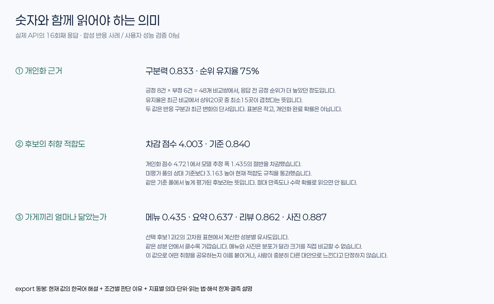
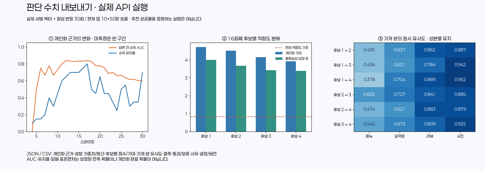

# 선택 제안 판단 수치 내보내기

[클라이언트 연동: 기존 API 유지·필요할 때 수치 조회](DECISION-CLIENT.md)

**운영 제공 중(2026-09-14 배포).** 기본 주소 `http://api.example.com`.
[운영 검증·화면·호출 방법](../analysis/backtest/results/decision-deploy-20260914/README.md).

고차원 벡터에서 계산한 유사도와 현재 추천 모델의 판단 근거를 외부 분석에 사용하도록 내보낸다.
8개 성분은 원본 임베딩의 차원 수가 아니라 고차원 유사도·공방문·인기 등을 결합하는 점수 성분이다.
언어 태그나 2차원 지형 좌표로 대체하지 않는다. 원본 벡터 파일 전체를 응답에 싣지는 않는다.

**이 기능은 관측 가능성을 확보하는 변경이다. 현재 휴리스틱을 보정된 적합성/개인화 판단으로 개선한 변경은 아니다.**
판단 기준의 한계는 [설계 검토서](DECISION-DESIGN-REVIEW.md)에 기록되어 있다.

## 숫자와 함께 제공하는 설명

API 응답에는 `reading`(현재 값의 한국어 해설), `metric_guide`(지표별 의미·단위·읽는 법·
해석 한계·결측 의미), `gates[].explanation`(각 조건의 통과/미통과/미측정 설명)이 함께 들어간다.
파일 export에는 같은 설명을 담은 `READ-ME.md`와 `metric-guide.csv`가 포함된다.

예제의 숫자는 다음처럼 읽는다. **실제 벡터에 합성 반응을 넣은 사례**다.

| 관측 | 의미 | 이 값만으로 판단할 수 없는 것 |
|---|---|---|
| AUC .833, 긍정8건·부정6건 | 답변 전 순위를 남긴 기록48쌍을 비교한 구분력. 긍정 순위가 높으면1, 동점이면.5로 평균 | 개인화가83.3% 완료됐거나 새 가게를83.3% 확률로 좋아한다는 해석 |
| 순위 유지율 .75 | 한 번 전·세 번 전 상위20과 비교했을 때 최소15곳 겹침 | 안정된 순위가 정확하다는 결론 |
| 후보1 차감 점수4.003, 기준.840 | 개인화4.721에서 모델SD1.435의 절반을 차감. 당시 미평가 풀 기준보다3.163 높아 상대 적합도 규칙 통과 | 절대 만족도4점, 수락 확률, 다른 후보 풀에서도 같은 의미를 갖는 점수 |
| 후보1↔2: 메뉴.435, 리뷰.862 | 두 가게의 각 고차원 표현에서 계산한 서로 다른 성분의 유사도 | 리뷰가 메뉴보다 두 배 닮았다거나, 사람에게 충분히 다른 선택지라는 결론 |

설명은 현재 관측·실제 분모·사용한 설정에 연결한다. 근거가 없으면 '미측정'으로 설명하고,
벡터 값만 보고 '일식을 좋아한다' 같은 언어화된 취향을 임의로 만들어 붙이지 않는다.



상세 응답의 `decision`, `gates`, `slate`는 **자동 권유(mode=auto) 기준**을 나타낸다.
기본 manual decision은 이 검증을 기다리지 않고 현재 후보를 제공하므로 두 ready가 다를 수 있다.
manual 카드끼리의 유사도는 반환한 card_ids를 summary에 지정해 측정한다.

## 반환하는 수치

| 영역 | 주요 값 | 해석 |
|---|---|---|
| `personalization` | 고유 평가/긍정/부정 수, 답변 전 순위 AUC, 라벨별 검증 수, 최근30 예측/실제 응답, n−1/n−3 유지율 | 준비 전에도 계산. 순위 안정성이나 AUC가 개인화 완료 확률은 아님 |
| `model` | 8개 성분 가중치·분산·표준편차, 개인화 점수 포함 여부 | 고차원 임베딩 자체의 분산이 아닌 결합 가중치의 대각 근사 |
| `candidates` | 전체/개인화 점수, 모델 SD, 보정 후 점수, 적합도 기준과의 차이, 기준 풀 백분위, 실제 정렬 보정 | 상대 점수를 만족 확률로 바꾸지 않음 |
| `candidates[].components` | 성분별 z, 가중 기여, 분산 기여 | 합산 전 성분을 유지하여 실제 계산을 재구성 가능 |
| `candidates[].evidence` | 성분 보유 여부, 좋아요/싫어요 근거 중 관측 가능한 수, 가장 가까운 근거 가게와 원시 유사도 | 자기 가게는 참조에서 제외. 결측에 따른 근거량 차이 확인 |
| `pairs` | 메뉴/요약문/리뷰/음식사진 원시 유사도, 공방문 유사도, 결측, 현행 평균, 브랜드/세부 업종 일치, 차단 사유 | 서로 다른 성분의 원시 값을 보존. 현재 판단이 어느 값/규칙에서 나왔는지 확인 |
| `fit`, `slate` | 적합 후보 수, 기준 풀과 분위수, 탐색 범위/잘림, 진단 조합, 최소 적합도 여유, 가장 겹치는 쌍과 모든 쌍 | 탐색 실패와 근거 부족을 구분할 자료. 진단 조합은 권유가 아닐 수 있음 |
| `gates` | 측정값·비교 연산·기준값·통과 여부 | 미측정은 `null`, 미통과는 `false`. 각 조건을 독립 관측 |
| `config`, `provenance`, `snapshot_id` | 임계값 전체, 서빙 manifest·벡터 원천·계산 코드 해시, 상태 식별자 | 수치 출처와 동일 시점 페이지 결합 확인 |

`total_score = Σ contribution`, `personal_score = 개인화 성분 contribution의 합`,
`model_sd² = 개인화 성분 variance_contribution의 합`이다.
`conservative_score = personal_score − uncertainty_weight × model_sd`이며
`fit_margin = conservative_score − fit.threshold`다. 조건은 margin≥0 **및** personal_score>0이다.
서로 다른 후보 풀의 z 점수는 같은 절대 척도가 아니다. 프레임 간 비교 시 기준 풀·설정도 함께 읽는다.

최종 후보는 과거 좋아요/싫어요/노출로 제한하지 않는다. 성분 채점에서 자기 참조를 뺐다는 것은
해당 반응을 학습한 가중치까지 LOO 재학습했다는 뜻이 아니다.

## 클라이언트용 경량 조회

`GET /users/{user_id}/decision/metrics/summary?card_ids=12&card_ids=34`로 화면 카드만 측정한다.
최대20개, 기본은 카드 지정 없음. 개인화 준비 여부·예측 구분력/안정성 점수·적합 가게 수·
가장 비슷한 쌍의 점수와 카드 ID·다양성 통과 여부만 반환한다. 필드 의미는 OpenAPI와 연동 문서에 둔다.
서버는 상세 API와 동일한 전체 후보 분석·자기 참조 제외·개인화 검증·조합 탐색을 수행한 뒤 필요한 값만 반환한다.
경량화는 전송하는 응답 크기 기준이다. 이 문서 아래의 상세 분석 응답 계약은 유지한다.
[요청·응답 사용법](DECISION-CLIENT.md).

## API

### 현재 시점 JSON

`GET /users/{user_id}/decision/metrics?download=true`

`download=true`는 JSON 첨부 다운로드 헤더를 붙인다. `schema_version=1`, 응답 타입 `DecisionMetricsOut`.
`/docs`와 `/openapi.json`에 중첩 타입을 포함한다. 기존 제안 API와 같은 사용자 존재 검사를 적용한다.
학습·난수·노출을 변경하지 않는다. GET에는 `Cache-Control: no-store`를 설정한다.

후보는 통과 후보가 먼저 나오고, 각 그룹 안에서는 기존 tier·점수/거리 보정·store_id 순서다.
`rank`는 이 진단 목록의 위치이며 전체 추천 모델의 순위와 혼동하지 않는다.

| 쿼리 | 기본 / 범위 | 기능 |
|---|---|---|
| `candidate_limit` | 60 / 1~200 | 한 페이지의 후보 수 |
| `candidate_offset` | 0 / 0 이상 | 후보 페이지 시작점 |
| `snapshot_id` | 생략 가능 | 이전 페이지 값과 다르면 409. 이어받기 시 반드시 사용 |
| `pair_store_ids` | 생략 / 최대20개 | 반복 쿼리로 지정한 자격 풀 내 가게의 모든 쌍. 중복 ID 제거 |
| `download` | false | JSON 파일 다운로드 |
| `n` | 4 / 1~20 | 선택 제안 API와 같은 제안 장수 |

`next_offset`이 null까지 읽으면 자격 풀 전체를 얻는다. 페이징 도중 상태가 달라져 409가 나면
내보내기를 다시 시작한다. 서버가 과거 페이지를 영구 보관하는 방식은 아니다.
기본 쌍은 제안된 n곳의 n(n−1)/2쌍(기본4곳의6쌍), 미제안이면 진단 상위8곳의 최대28쌍이다.
명시한20곳에서는 최대190쌍을 내보낸다. **전체 카탈로그의 모든 쌍을 내려받았다고 표시하지 않는다.**
후보 페이지와 쌍의 범위는 독립이며 `pair_scope`·`pair_store_ids`로 범위를 명시한다.
자격 풀 밖/알 수 없는 pair ID는 422, 알 수 없는 사용자는 404다.

### 각 스와이프 직후 수치

`POST /preferences?include_decision_metrics=true`

기존 요청 본문을 사용하면 `decision_metrics` 필드에 해당 피드백을 반영한 직후 상태의 수치를 반환한다.
`include_decision=true`를 함께 주면 기존 제안 응답도 받는다. 두 옵션은 독립이다.
옵션 생략 시 `decision_metrics: null`이며 상세 계산은 실행하지 않는다.

현재 프로세스 안에서 사용자별 피드백 잠금으로 학습과 스냅샷 복사를 연결했다. 이후 다른 반응이 들어와도
이 응답의 **학습 상태**는 바뀌지 않는다. 필터/위치는 수치 평가 시점에 조회하며 학습 트랜잭션의 일부는 아니다.
분석 클라이언트는 피드백 요청을 순서대로 보내고 `feedback_count`·`snapshot_id`와 함께 응답을 저장한다.
두 옵션을 함께 요청하면 일반 `decision`과 `decision_metrics`가 **같은 피드백 스냅샷과 한 번 조회한
필터/위치 범위**를 사용한다. 별도의 동시 피드백이 들어와도 한 응답 안의 판단 시점을 맞춘다.

서버가 상세 수치를 매번 런타임 파일에 자동 누적하지는 않는다. 운영 원본·대용량 상태 증가를 피하기 위해
분석 클라이언트가 선택한 요청의 응답을 JSONL 등으로 저장한다. 기존 앱은 아직 이 옵션을 호출하지 않는다.

### JSON + CSV 파일

백엔드가 실행 중일 때 다음 분석 도구로 같은 시점의 **전체 후보**를 페이지 조회하고 파일로 저장한다.

```bash
cd BE
python analysis/export_decision_metrics.py \
  'http://localhost:8000/users/USER_ID/decision/metrics' \
  --output-dir /tmp/decision-export
```

결과: `decision-metrics.json`, `READ-ME.md` 및 `candidates.csv`, `components.csv`, `evidence.csv`, `pairs.csv`,
`gates.csv`, `model.csv`, `predictions.csv`, `metric-guide.csv`. 모든 CSV 행에 snapshot_id·feedback_count를 포함한다.
JSON 결측은 null, CSV 결측은 빈 칸이다. CSV를 불러올 때 빈 칸을 0으로 변환하지 않는다.
후보는 전체지만 쌍은 API의 지정 범위다. 중간 상태 변경이나 오류 시 파일 작성 전에 중단한다.

## 검증 자료



[실제 응답 예제 JSON](../analysis/backtest/results/decision-20260914/metrics-export-example.json),
[HTTP 검증 집계와 출처](../analysis/backtest/results/decision-20260914/metrics-export-check.json).
예제 JSON은 `candidate_limit=4`로 받은 실제 페이지다. 기본 쌍은 제안4곳 기준이므로
페이지 안 후보와 쌍에 등장하는 가게는 다를 수 있다. 전체 스와이프 수집은 기본60 후보로 실행했다.
예제는 실제 고차원 벡터 산출물에 **합성 반응**을 넣은 것이며 실제 사용자 성능 측정이 아니다.
이전 한식 예제 seed2000의 현재 앱10+50장 경로를 30회 재생했다.

- 30회 모두 기존 제안 여부/가게와 수치 응답의 결정이 일치. 후보 측정 1,800행 수집.
- 첫 제안16회째의 가게4곳/6쌍을 표시. 제안 전/후 진단값도 계속 반환.
- 30회째 전체 자격 후보1,629곳을 동일 snapshot으로 페이지 조회해 누락·중복 없음 확인.
- 새 테스트: 성분 합계와 실제 채점 일치, 원시 유사도/결측 보존, 조기 보류 시 측정,
  읽기 전용, 피드백 잠금/분리된 복사, 다운로드·페이지409·옵션 기본값·CSV 변환·OpenAPI.
- 최신 데이터 외부 마운트 변경 통합 후 전체 회귀 테스트 **323 passed / 10.83초**, 의존성 deprecation 경고2개.
  동시 피드백 중 결합 응답의 같은 시점 보장과 기존 위치/필터/카드 흐름 연계를 포함한다.
  기존 추천 기준의 제품 타당성을 증명하는 테스트는 아니다.
- 상세 조회는 수치 계산과 직렬화 비용이 있다. 측정 지연은 검증 JSON에 기록하며,
  실제 네트워크·모바일 지연과 구분한다. 전체 후보를 매 스와이프 내려받는 것은 기본 동작이 아니다.

재현:

```bash
cd BE/server
python -m pytest tests -q
cd ..
python analysis/capture_decision_metrics.py \
  --output-dir /tmp/decision-metrics-report \
  --trace-output /tmp/decision-metrics-trace/metrics-trace.jsonl
```

학습 데이터/벡터 재생성, 제안 기준 보정, 모바일 자동 권유 연동은 이번 export 구현에 포함되지 않는다.
