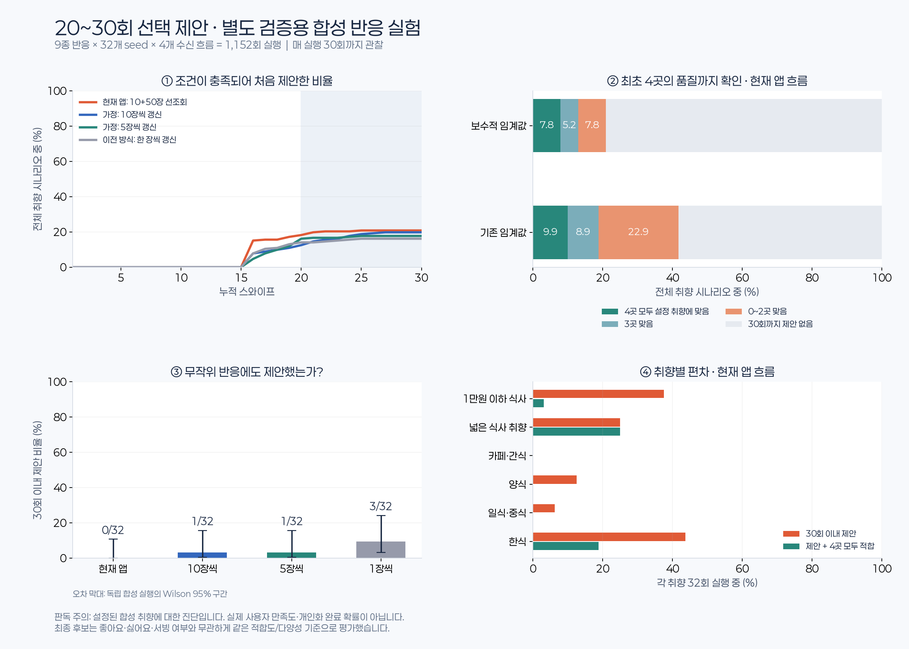

# 스와이프 중 4곳 선택 제안

[클라이언트 연동: 기존 API 유지·필요할 때 수치 조회](DECISION-CLIENT.md)

> **현재 동작(2026-09-17): 아래 실험은 자동 권유 기준을 검증한 기록이다.**
> 기본 `GET …/decision`은 점수와 무관하게 현재 후보를 주는 manual이다.
> 자동 권유는 `?mode=auto` 또는 스와이프의 `include_decision=true`로 요청한다.
> 점수는 원래 개인화 검증 근거 수준이며 추천 진입을 막지 않는다. 최신 계약은 위 연동 문서를 따른다.

[판단 수치 export API·JSON/CSV·실제 측정 그림](DECISION-METRICS.md): 개인화 근거, 후보별 점수 분해,
고차원 벡터에서 온 성분별 가게 쌍 유사도를 준비 전에도 내보낸다. 판단 기준의 검증과는 구분한다.

> **설계 재검토(2026-09-14): 아래 기준은 검증된 제품 판단 기준이 아니라 실험용 휴리스틱이다.**
> 원시 유사도 평균, 상대 순위에 의한 적합도, 순위 안정성에 의한 개인화 판단의 결함을
> 실제 데이터와 대조했다. [설계 검토서·재설계 계약](DECISION-DESIGN-REVIEW.md)을 먼저 참고한다.
> 20~30회 목표와 실제 사용자 타당성은 미입증이며 MR은 Draft다.

기존 추천·스와이프를 계속하면서 **개인화 근거, 후보의 취향 적합도, 후보 간 다양성**을
모두 충족하면 요청한 n곳을 권유한다(기본4, API 범위1~20). 목표 구간은 20회 안팎에서 30회까지다.
30회라는 이유만으로 조건을 완화하지 않는다.

최종 후보의 과거 선호 여부는 자격 조건이 아니다. 좋아요한 가게를 모으는 별도 흐름은
없으며, 좋아요·싫어요·서빙 여부와 무관하게 현재 자격 풀을 평가한다. 응답의 `liked`는
표시용 정보일 뿐이다. 저장된 필터·거리·사진/가격 자격은 유지한다.

## 판단 기준

| 조건 | 현재 구현 |
|---|---|
| 충분한 개인화 근거 | 서로 다른 16곳 이상 평가, 긍정 근거 3곳 이상. 답변 전에 계산한 개인화 순위의 최근 30개 유효 예측에서 좋아요/싫어요 각 5개 이상, 구분 AUC ≥ 0.70. 각 3개였을 때는 교환 비교가 3×3 = 9쌍뿐이라 8쌍만 맞혀도 AUC 0.80을 넘었다 — 운으로 넘을 수 있는 크기여서 5개(25쌍)로 올렸다. 현재/n−1/n−3 개인화 상위 20곳의 최소 유지율 ≥ 60% |
| 후보의 취향 적합도 | 인기·평판을 제외한 개인화 점수에서 0.5×모델 근사 표준편차를 뺀 값이 미평가 풀의 상위 25% 이상, 개인화 기여 > 0. 이미 평가한 후보는 유사도 집계에서만 자기 반응 제외. 가중치는 해당 반응을 포함해 학습되어 완전한 LOO 검증이 아님 |
| 후보 간 다양성 | 동일 브랜드·동일 세부 업종 금지. 메뉴 유사도 < 0.85, 알려진 메뉴/요약/리뷰/음식사진 유사도 평균 < 0.80. 알려진 성분이 2개 미만이면 다양성을 확정하지 않음 |

같은 '한식'이라는 대분류를 금지하지는 않는다. 국밥/한정식/고기 등 세부 업종을
구별한다. 수치상 유사도가 낮아도 화면에 고깃집이 여러 곳 나오는 문제를 실제 캡처에서
발견하여 세부 업종 규칙을 추가했다. 이 규칙도 사람이 느끼는 다양성을 완벽히 증명하지는 않는다.

필터를 통과한 후보를 태그 일치 수·거리 보정으로 정렬하고 상위 60곳에서 4곳 조합을
되돌리기 탐색한다. 유효한 조합이 60위 밖에만 있으면 보류할 수 있다는 계산량 제한이 남는다.

`recsys/decision.py:Config`에 임계값을 모았다. **대부분은 여전히 제품 가설이다.**
예외가 `min_validation_auc`다 — 0.80은 합성 사용자로 정한 가설이었고, 운영 기록
10,384줄(16장 이상 답한 72명) 재생으로 0.70을 골랐다. 0.80에서는 `ready`를 한 번이라도
본 사람이 14명·마지막이 100%인 사람 2명뿐이었는데 0.70에서 29명·5명이 된다. 대가는
`ready`인 동안 답한 카드의 예측 적중률이 70.8% → 66.1%로 내려가는 것이다(전체 평균
58.3%보다는 높다). 더 낮추지 않은 이유는 완화(`requirements`)가 이 값을 0.75배까지
깎기 때문이다 — 0.65면 실효 문턱이 0.4875로 동전 던지기 밑으로 간다. AUC는
서로 다른 시점의 온라인 예측을 모은 진단이며, 통계적 유의확률이나 만족 확률이 아니다.
안정된 모델도 틀릴 수 있고, 반복 검사 때문에 무작위 반응이 우연히 통과할 수 있다.
표준편차 보정 역시 보정된 신뢰구간을 뜻하지 않는다.

## API와 구현 범위

- `POST /preferences?include_decision=true`: 기존 저장/학습 이후 `decision`에 판정과 4장 반환.
- `GET /users/{user_id}/decision?mode=auto`: 자동 권유 재평가. 둘 다 OpenAPI `DecisionOut` 계약을 제공한다.
- 성공이면 정확히 n장(기본4), 그 외 빈 배열과 보류 사유. 같은 `proposal_id`로 중복 권유를 억제한다.
- 조회 자체는 모델·난수·스와이프 노출을 변경하지 않는다. 학습 시 최근 4개 체크포인트와
  답변 전 예측을 메모리에 남기며, 기존 선호 로그 재생으로 같은 값을 복원한다.
- 모델 가중치 갱신·인터리빙 정책은 유지한다. 현재 앱의 10+50장 선조회도 바꾸지 않았다.
- 프론트 자동 권유/비교 화면/수락·거절 기록은 아직 연동하지 않았다. 캡처는 실제 API
  응답을 표시한 **검증용 뷰어**다. 서버는 배포되어 있으며 MR은 병합하지 않았다.

## 이전 20회 테스트의 타당성 검토

이전 `tests/probe_decision.py`는 작은 동작 프로브였으며, 제품 목표를 입증하는 평가로
사용하기에는 부적절했다. 혼동을 막기 위해 제거하고 실제 경로를 쓰는 검증 도구로 교체했다.

1. 앱은 초기 10장+추가 50장을 선조회하지만 프로브는 반응마다 1장을 새로 추천했다.
   온라인 학습이 다음 노출에 반영되는 시점이 달랐다. 라우터의 배치 선발도 재현하지 않았다.
2. 유형당 seed 4개라 편차가 컸고, 같은 사례를 보며 기준을 조정한 뒤 독립 재검증이 없었다.
3. 제안 시점에 중단해 이후 30회 흐름과 미제안 사유를 충분히 보지 않았다.
4. 반응 난수를 스와이프 순서대로 뽑아 정책별로 같은 가게에 다른 반응을 줄 수 있었다.
5. 업종 기반 합성 반응은 실제 사용자 취향이 아니다. 추천 대상의 정답을 정의한 가정이지
   모델의 현실 만족도 증거가 아니다.
6. 제안률만 높아져도 성공으로 오해할 수 있다. 제안된 **최초 4곳**의 품질과 잘못된
   권유, 제안하지 못한 전체 사례를 함께 봐야 한다.

## 교체한 검증

- `analysis/decision_validation.py`: 실제 `policy.pick_many`/`record` 사용. HTTP와 카드 순서,
  모델 가중치, 선호 이력이 일치하는 별도 테스트로 검증 도구 자체를 확인했다.
- 가게별 반응을 사용자·seed·가게로 고정한다. 정책/배치 비교에서 같은 가게의 반응이 같다.
- 현재 앱의 10+50장을 기본 경로로, 1장/5장/10장 갱신은 비교 가정으로 구분한다.
- 6개 취향 가정(업종 5종+메뉴 가격 조건)과 무작위/전부 싫어요/전부 좋아요의 대조군.
  임베딩 점수를 정답으로 사용하지 않는다. 다만 모델과 같은 메타데이터를 공유하므로
  외부 타당성이 보장되는 독립 사용자 데이터라고 주장하지 않는다.
- 개발 seed 0~7로 초기 기준(12/.70)과 보수적 기준(16/.80)의 품질/제안률 교환을 확인.
  세부 업종 보완 후 최종 기준을 고정하고 **별도 seed 2000~2031**로 최종 검증했다.
  앞서 검사한 seed 1000~1031은 최종 독립 검증으로 재사용하지 않았다.
- 9종×32seed×4경로 = 1,152개 실행을 각각 30회까지 관찰한다. 시간 지점을 독립 표본으로
  부풀리지 않으며, 최초 제안의 품질을 이후 더 좋은 제안으로 바꿔 세지 않는다.
- 20/25/30회 누적 제안률, 전체 분모 기준 '제안+4곳 모두 적합', 무작위 반응의 권유율,
  seed 단위 구간, 평가 전체/조기 보류 지연을 분리해 기록한다.

**합성 실험의 개선과 실제 추천 성공의 입증은 다르다.** 시뮬레이터가 만드는 편향과
반사실 평가에 필요한 무작위 노출 조건은 [Li et al., WSDM 2011](https://arxiv.org/abs/1003.5956)이
설명한다. 운영 로그에는 노출 확률이 없어 여기서는 불편 오프라인 정책 평가를 주장하지 않는다.

매 스와이프마다 검사하는 지표를 고정 표본 검정처럼 해석해서도 안 된다. 시간 전체에 유효한
추론은 별도 방법이 필요하며 [Howard et al., 2021](https://arxiv.org/abs/1810.08240)을 참고했다.
현재 구현은 그러한 통계적 보장을 구현했다고 주장하지 않는다. 무작위 대조군으로 발생 빈도를
직접 보고하며, Wilson 구간은 **독립 합성 실행**의 제안 비율에 대한 요약이다.

## 결과와 재현

[최종 검증 보고서·수치](../analysis/backtest/results/decision-20260914/README.md)



(실제 API 4장 응답 캡처는 가게 사진이 들어 있어 공개본에서 뺐습니다.)

```
cd BE/server
python -m pytest tests -q
cd ..
python analysis/decision_validation.py --split development --output /tmp/decision-dev.json
python analysis/decision_validation.py --split holdout --seed-start 2000 --output /tmp/decision-final.json
python analysis/plot_decision_validation.py /tmp/decision-final.json --output-dir analysis/backtest/results/decision-20260914
python analysis/capture_decision_example.py /tmp/decision-final.json --output-dir analysis/backtest/results/decision-20260914
```

분석/캡처 의존성은 `analysis/requirements-decision.txt`. 캡처에는 Playwright Chromium이
필요하다. 합성 원시 실행 이력은 임시 산출물이며 MR에는 코드·집계·시각자료만 포함한다.
운영 원본·계정·토큰은 포함하지 않는다.
