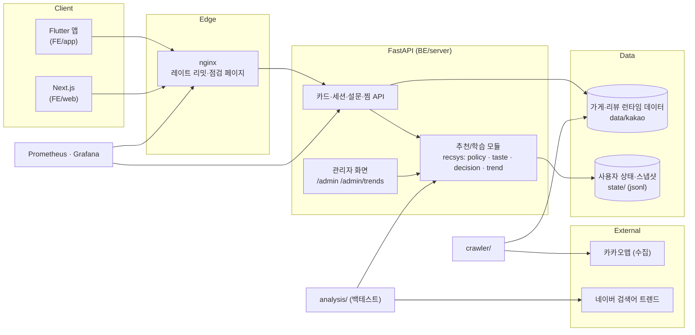

# 맛추리 (matchuri)

스와이프로 취향을 배워 음식점을 추천하는 서비스 — SSAFY 15기 1학기 특화 프로젝트(빅데이터 추천), **우수 프로젝트**.


사용자는 역삼동 음식점 카드를 숏폼처럼 넘기며 좋아요/싫어요를 누르고, 서버는 그 반응으로 취향을 학습해 다음 카드를 고르고,
충분히 배웠다고 판단되면 후보 4곳을 제안합니다. 스와이프 한 번이 1비트뿐이라 "취향"과 "의도"를 같이 재기 어렵다는 점이
이 프로젝트가 계속 부딪힌 문제였습니다.

> 6인 팀 프로젝트입니다(FE·QA·디자인·기획 / BE·추천). 이 저장소는 공개용 사본이며, 수집 데이터와 운영 비밀값은 포함하지 않습니다.

## 내 역할 — 백엔드 추천·학습

팀 백엔드 중 **추천·학습·운영** 쪽을 맡았습니다. 아래는 커밋 기록(`git blame` 기준 내 줄이 가장 많은 파일)과 개인 작업 일지로 확인한 것입니다.

| 영역 | 한 일 | 코드 |
|---|---|---|
| 취향 학습·정책 | 스와이프 반응으로 카테고리·가격·태그 가중치를 갱신하는 정책, 팀-드래프트 인터리빙으로 정책 비교 | `BE/server/recsys/policy.py` |
| 후기 표현력 채점 | 리뷰 문장이 얼마나 구체적인지 채점해 후기 노출 순서를 정함. 후기 게이트(삭제)를 없애고 순서로만 쓰도록 실데이터로 뒤집음 | `recsys/expressiveness.py`, `app/user_reviews.py` |
| 트렌드 | 네이버 검색어 트렌드로 계절·유행·스테디셀러 축을 관측하고, 10장에 1장 슬롯으로 노출해 실측으로 검증(슬롯 like 48.8% 대 일반 65.5% — 구간이 겹치지 않아 전역 반영은 보류) | `recsys/trend*.py`, `app/admin_trends.py` |
| 방문·설문 | 길찾기 → 3시간 뒤 설문 → 방문 검증 흐름, 설문 사진 업로드(EXIF 제거·크기 제한) | `app/journeys.py`, `app/media.py` |
| 선택 제안 준비도 | "충분히 배웠나"를 예측 적중 누적으로 계산하는 진행 점수와 `ready` 판정 | `recsys/decision_summary.py` |
| 안정 ID·영업시간 | 가게 목록이 바뀌어도 `card_id` 가 밀리지 않는 기준선, 자정 넘김·브레이크타임을 반영한 영업 여부 계산 | `app/card_ids.py`, `app/hours.py` |
| 기동·배포 | 배포 후 학습 상태 스냅샷 복원, 준비 게이트(`/readyz`), Jenkins 파이프라인, nginx·모니터링 | `app/snapshot.py`, `app/boot.py`, `BE/Jenkinsfile`, `BE/nginx/` |

개발 중 판단의 근거는 계약·반박 검토·실측 숫자로 남겼고, 안 하기로 한 것도 기록했습니다(예: 성능 개선은 규모가 작아 보류, 트렌드 전역 반영은 실측 결과가 나빠 보류).

## 시스템 구성



저장소는 `BE/`(crawler → server → analysis, 서로 데이터로만 이어짐)와 `FE/`(앱·웹)로 나뉩니다. DB 없이 jsonl 상태 파일과 시작 시 스냅샷 복원을 쓰며, 이전 기준은 [explainer](docs/explainer.md)에 적어 두었습니다.

## 주요 화면 컴포넌트 (FE/app, Flutter)

| 컴포넌트 | 역할 |
|---|---|
| `screens/bootstrap_gate.dart` | 앱 시작 시 사용자·세션 확인과 생성, 튜토리얼 완료 여부 분기 |
| `screens/onboarding_screen.dart` · `tutorial_screen.dart` | 첫 실행 등록과 사용법 안내 |
| `screens/frame_screen.dart` | 하단 내비게이션 프레임, 세션·필터 보관 |
| `screens/home_screen.dart` | 카드 스와이프 메인. 카드 조회, 스와이프 전송, 학습 게이지, 선택 제안 호출 |
| `screens/filter_screen.dart` | 위치·업종·태그·반경 필터 설정 |
| `screens/restaurant_detail_screen.dart` | 가게 상세(메뉴·리뷰·사진), 찜 |
| `screens/mark_screen.dart` | 찜한 가게 목록 |
| `screens/my_screen.dart` | 내 취향 지형도(업종 계층 궤적) |
| `screens/visit_review_screen.dart` | 방문 후 설문(맛·가격·분위기)과 후기 작성 |
| `screens/decision_proposal_dialog.dart` | 취향이 모였을 때 후보 가게를 제안하는 대화상자 |
| `widgets/card_widget.dart` | 스와이프 카드 한 장(사진·태그·찜) |
| `widgets/directions_sheet.dart` | 길찾기 연결과 방문 감지(지오펜스) |
| `widgets/restaurant_list_card.dart` · `menu_tile.dart` · `tag_chip.dart` · `original_photo_viewer.dart` · `primary_button.dart` | 목록 카드·메뉴 행·태그 칩·원본 사진 뷰어·공통 버튼 |

`FE/web` 은 Next.js 16 + Tailwind v4 로 만든 웹 스와이프 카드 화면입니다(`SwipeCard`, `RestaurantSwipeCard`).
컴포넌트 역할은 화면 파일의 호출 API와 이름으로 정리한 것입니다.

## API

전체 명세는 **[docs/API.md](docs/API.md)**(호출 순서·필드·에러), 타입 생성용 요약은
`BE/analysis/backtest/results/openapi-20260910.md`, 로컬에서는 `http://127.0.0.1:8000/docs`(Swagger)입니다.
아래 경로는 라우터 코드(`BE/server/main.py`, `app/user_api.py`) 기준이며, `S` = `/user/{user_id}/session/{session_id}` 입니다.
세션 경로는 기존 `/users/{user_id}/...` 라우트를 세션 단위로 복제한 것입니다.
**★** 는 내가 만든 엔드포인트(소유자 `git blame` 기준)입니다.

| 메서드 | 경로 | 하는 일 | |
|---|---|---|---|
| POST | `/user` | 사용자 생성 | |
| POST / GET | `/user/{user_id}/session` | 추천 세션 생성 / 목록 | |
| GET | `S/cards?limit=` | 세션 기준 추천 카드 | |
| POST | `S/preferences` | 스와이프(좋아요/싫어요) 기록, 학습 갱신 | |
| GET | `S/taste` | 세션 취향 궤적 | |
| PUT / DELETE | `S/location` · `S/filter` | 위치·필터 저장/삭제 | |
| GET | `S/decision` | 선택할 가게 4곳 제안 | |
| POST | `S/decision/feedback` | 제안 결과(select/continue) 기록 | |
| GET | `S/decision/metrics/summary` | 준비도·판단 수치 | ★(준비도 계산) |
| GET | `/cards/{card_id}` · `/cards/{card_id}/reviews` | 카드 상세·리뷰 전체(사용자 후기 포함) | ★(후기 섞기) |
| GET | `/filters` | 필터 어휘 | |
| PUT / DELETE / GET | `/users/{user_id}/bookmarks[/{card_id}]` | 찜 | |
| POST | `/users/{user_id}/directions` | 길찾기 기록(방문 의사) | ★ |
| GET | `/users/{user_id}/surveys/pending` | 설문할 가게 | ★ |
| POST / GET | `/users/{user_id}/surveys` | 설문 답하기 / 답한 목록 | ★ |
| POST / DELETE | `/users/{user_id}/surveys/{card_id}/photos[/{photo_id}]` | 설문 사진 | ★ |
| GET | `/taste/map` · `/taste/map/children` | 업종 지형도 | |
| GET | `/healthz` · `/readyz` · `/metrics` | 생존·준비·Prometheus | |
| GET | `/admin/api/trend/*` | 트렌드 관측(관리자) | ★ |

## 실행 방법

```bash
cp .env.example .env            # 트렌드 수집 스크립트를 돌릴 때만 값이 필요하다

cd BE/server
pip install -r requirements.txt
uvicorn main:app --reload --port 8000    # http://127.0.0.1:8000/docs , /admin
```

- **데이터는 이 저장소에 없습니다.** 가게·리뷰·사진 URL 은 제3자 콘텐츠라 뺐습니다. 서버는 `BE/data/kakao/` 를 읽으므로,
  `BE/crawler/` 로 직접 수집한 뒤 `BE/data/kakao` 에 두어야 카드가 나옵니다([crawler README](BE/crawler/README.md)).
  `BE/data/card_ids.json`(카드 번호 기준선)과 트렌드 스냅샷 등 코드와 함께 도는 산출물은 포함되어 있습니다.
- 배포 구성(`BE/docker-compose.yml`, nginx, Prometheus/Grafana, `BE/Jenkinsfile`)은 참고용입니다. 서버 주소는 `api.example.com` 으로 바꿔 두었습니다.
- 앱: `cd FE/app && flutter run` (서버 주소는 `FE/app/lib/services/api_config.dart`). 웹: `cd FE/web && npm install && npm run dev`.
- 테스트: `cd BE/server && pytest tests` — 일부는 위 런타임 데이터가 필요합니다.

## 남은 한계

FE 가 선택·거절 결과(`decision/feedback`)를 서버로 보내지 않아, 선택하면 상·거절하면 벌을 주는 학습 루프가 운영에서 돌지 않았습니다.
서버 쪽 구현과 테스트는 있으나 효과는 실사용으로 확인하지 못했습니다.

## 문서

- [docs/API.md](docs/API.md) — 클라이언트 API 가이드
- [docs/explainer.md](docs/explainer.md) — 구조·배포·배경 지식
- [BE/README.md](BE/README.md) · [BE/server/README.md](BE/server/README.md) · [BE/analysis/README.md](BE/analysis/README.md)
